<p align="center">
  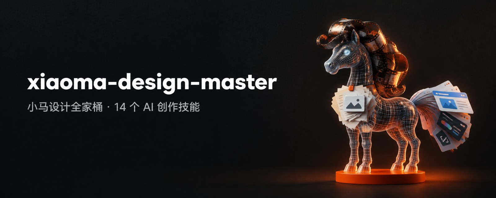
</p>

<h1 align="center">xiaoma-design-master</h1>

<p align="center">
  <b>小马设计全家桶 —— 16 个 AI 创作技能，一条命令装进你的 Agent。</b><br/>
  <i>From idea to award-worthy: writing, images, slides, video, 3D, and web UI — one skill suite for your AI agent.</i>
</p>

<p align="center">
  
  
  
  
</p>

---

## ✨ 技能总览

| 技能 | 一句话能力 | 类型 | 状态 |
|---|---|---|---|
| **xiaoma-studio** | 用代码做爆款级动效视频、HTML 幻灯片、动效官网 | 🎬 视频 | 🏆 成熟 |
| **xiaoma-opus3d** | three.js 纯代码搭建可嵌入网页的交互式 3D 场景 | 🏙️ 3D | 🏆 成熟 |
| **xiaoma-ppt** | 把任意文档套进你自己的 PPT 模板，出可编辑 pptx | 📊 PPT | 🏆 成熟 |
| **xiaoma-director** | 17 片种编导分镜表 + 分镜图 + 单文件 HTML 交付 | 🎬 视频 | 🏆 成熟 |
| **xiaoma-short-drama** | 8 片种短剧 / 漫剧：全剧单元与付费点 → 剧本 → 分镜 → 出片 → 剪辑 → 三评委自评 | 🎭 视频 | 🌱 v0.4 |
| **xiaoma-editor** | 逐镜片段拼成片：入出点、三层混音、字幕字卡、成片体检报告 | ✂️ 视频 | 🌱 v0.1 |
| **xiaoma-designer** | 海报/封面/KV/Logo 设计与评审，为生图模型写高质量提示词 | 🎨 设计 | 🏆 成熟 |
| **xiaoma-write-article** | 选题评分→框架→写作→去 AI 味→配图的深度长文生产线 | ✍️ 写作 | 🌱 v0.1 |
| **xiaoma-write-xhs** | 话题或长文 → 3:4 轮播小红书帖，交付发布就绪包 | 📕 写作 | 🌱 v0.1 |
| **xiaoma-de-ai** | 任意文本四级去 AI 味，附逐级对照报告 | ✨ 写作 | 🌱 v0.1 |
| **xiaoma-gen-image** | 五要素提示词 + 人物设计逻辑 + 两档生成的生图编排 | 🖼️ 图片 | 🌱 v0.1 |
| **xiaoma-gen-infographic** | 知识拆解 + 五大布局框架 + 提示词包的信息图生产线 | 📈 图片 | 🌱 v0.1 |
| **xiaoma-gen-cover** | 三创意方向 + 平台规格锁定的封面生产线 | 🎨 图片 | 🌱 v0.1 |
| **xiaoma-gen-video** | 导演式提示词 + 草稿试参数 + 确认出片的视频编排 | 🎥 视频 | 🌱 v0.1 |
| **xiaoma-video-script** | 3 秒钩子 + 口播逐字稿 + 分镜表的短视频脚本 | 📜 视频 | 🌱 v0.1 |
| **xiaoma-gen-ui** | 指定技术栈 + 10 大设计参考源 + awwwards 级品质自检 | 🖥️ 网页 | 🌱 v0.1 |

## 📊 我想做……用哪个？

| 你说 | 它接手 |
|---|---|
| "我要做个宣传片/动效视频（代码渲染）" | xiaoma-studio |
| "把这段视频拆成分镜 / 帮我出分镜表" | xiaoma-director |
| "做个 AI 短剧 / 漫剧，写剧本和分镜" | xiaoma-short-drama |
| "把这些片段剪成片，配乐加字幕" | xiaoma-editor |
| "用 AI 生成一段视频" | xiaoma-gen-video |
| "写个短视频口播脚本" | xiaoma-video-script |
| "把这个古镇做成 3D 网页模型" | xiaoma-opus3d |
| "把这份文档套进公司 PPT 模板" | xiaoma-ppt |
| "做张海报 / 封面 / KV" | xiaoma-designer |
| "给这篇文章配张封面" | xiaoma-gen-cover |
| "做张知识信息图" | xiaoma-gen-infographic |
| "生成一张图（要控制风格比例）" | xiaoma-gen-image |
| "写篇深度文章 / 公众号" | xiaoma-write-article |
| "做成小红书图文" | xiaoma-write-xhs |
| "这段太像 AI 写的，改改" | xiaoma-de-ai |
| "做个网站 / 落地页 / 作品集" | xiaoma-gen-ui |

## 🚀 安装

把下面这句话发给你的 AI 助手（Claude Code、pi 等任何会装技能的 Agent）：

```
帮我安装 https://github.com/crawfordxx/xiaoma-design-master 里的全部技能到你的技能目录
```

装完它就自然会说："✅ 已就绪，想创作什么？"

---

## 🎬 技能案例

### xiaoma-studio · 代码驱动动效视频

每一帧都是时间 t 的纯函数，先看拼图再出片。规则提炼自 30 条高赞爆款视频的逐帧拆解，附 15 张经典动效风格卡（等轴、扁平、像素、HUD、综艺花字等）、独立评委评审（不带制作上下文，7 维打分，每项 ≥ 7.5 才交付）、确定性渲染引擎（HTML→MP4）、合成配乐、多宽度截图体检。

<p>
  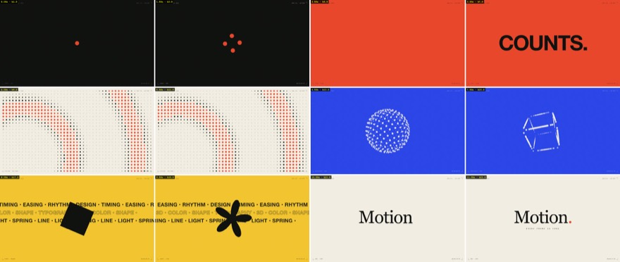
  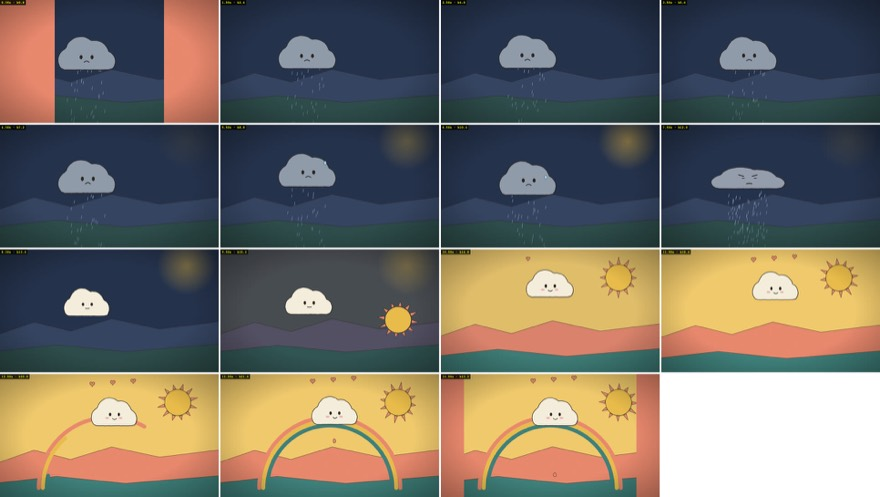
</p>

### xiaoma-opus3d · 交互式 3D 场景

平面图 → 分区施工 → 截图对比 → 打包成可双击打开、可 iframe 嵌入的单文件 HTML。鼠标拖动旋转、滚轮缩放、右键平移。

<p>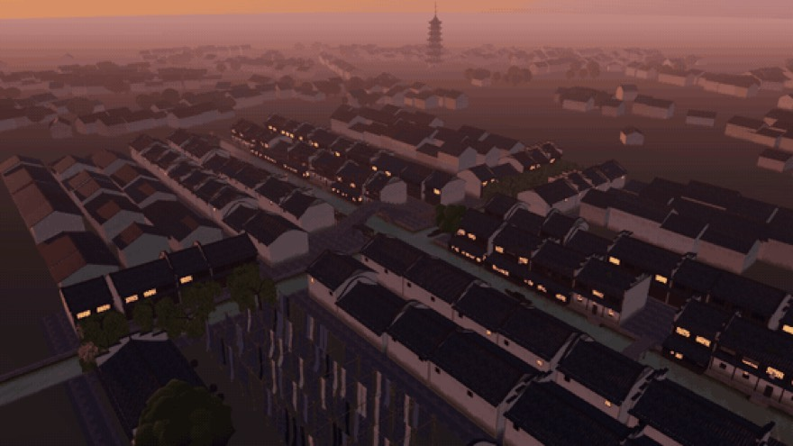</p>
<p><sub>乌镇水乡 · 完整动图见 <a href="showcase/xiaoma-opus3d/docs/preview.gif">preview.gif</a></sub></p>

### xiaoma-ppt · 模板套用生成可编辑 PPTX

自动拆解你的模板（版式/母版/色板/字体），按内容形态匹配版式，颜色字体全取自模板，背景 logo 原样保留——标准是"像模板本来就长这样"。

<p>
  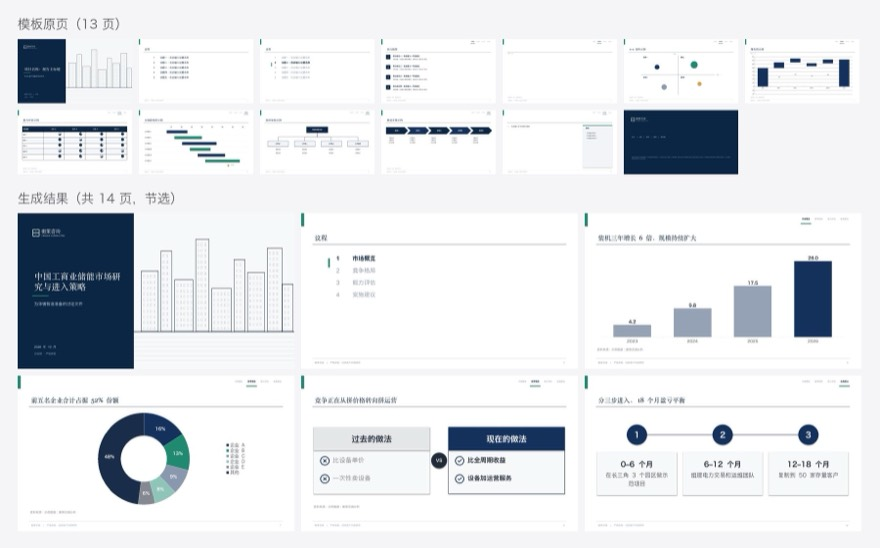
  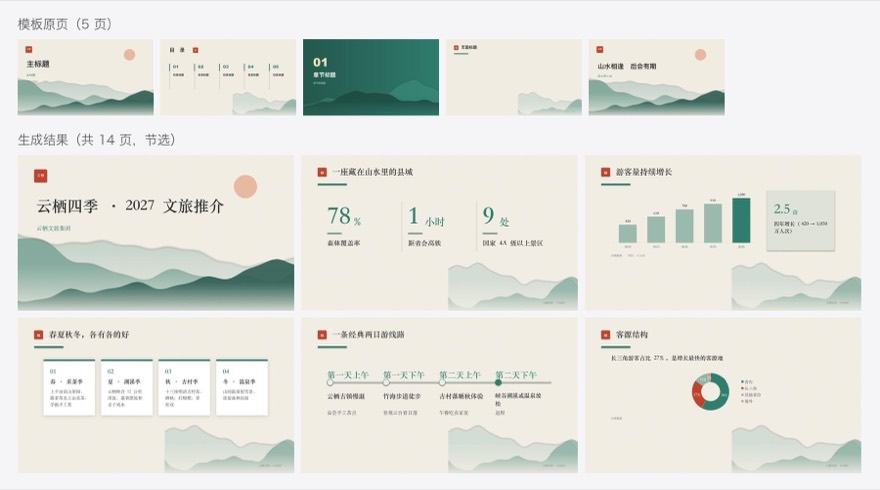
</p>

### xiaoma-director · 17 片种编导分镜

"我想做个视频" → 判定片种 → 按片种规矩写分镜表（镜号/时间码/景别运镜/画面/台词/音效/转场）→ 出图前过导演审核 → 每镜分镜图 → 单文件 HTML 交付。

<p></p>
<p></p>
<p></p>

### xiaoma-designer · 视觉设计与评审

设计 = 编码，观看 = 解码。海报、封面、KV、Logo、活动物料，或给现有设计打分改进——三层关评判标准，任何主题适用。

<p>
  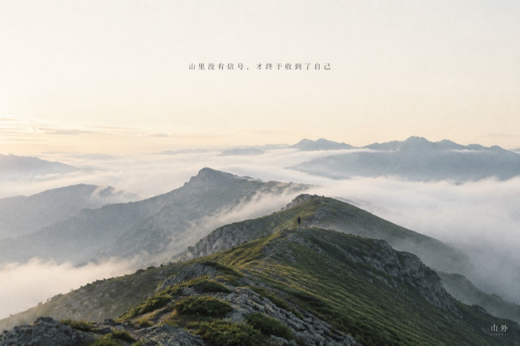
  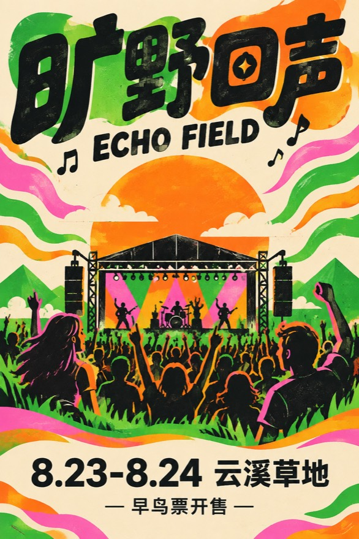
  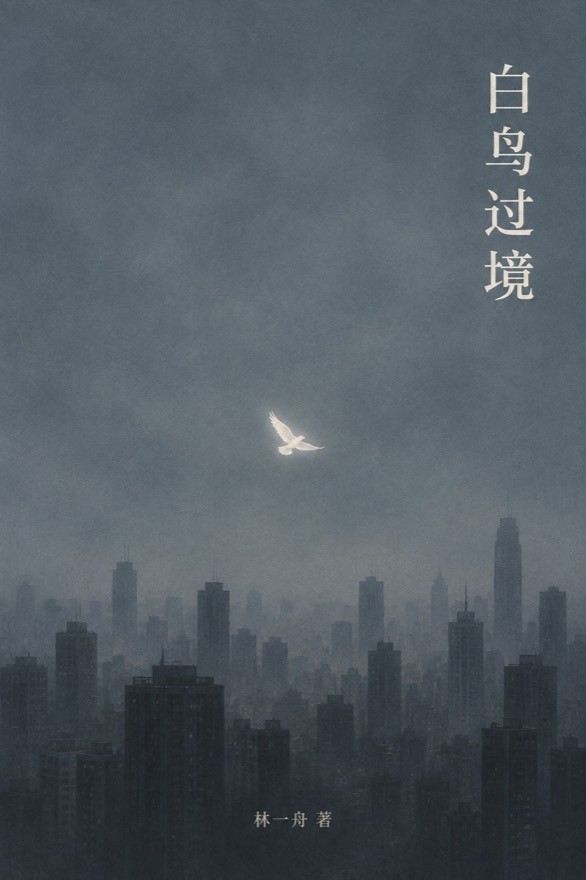
  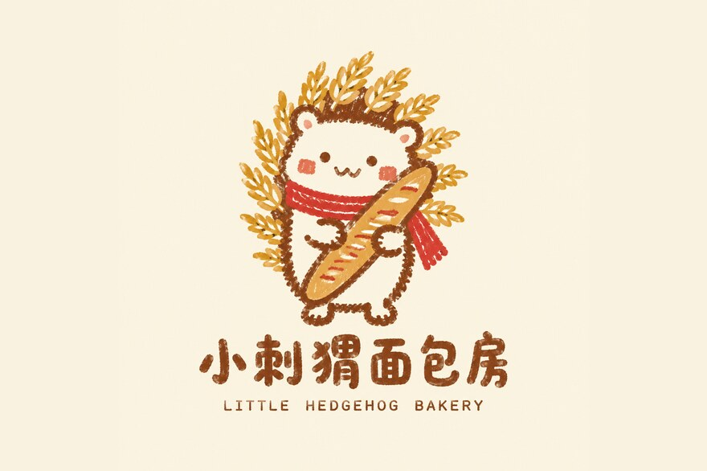
</p>

### xiaoma-write-article · 深度长文生产线

选题五维评分（每题带原子洞察草稿）→ 六大框架 → 写前八项思考 → 全文写作 → **四级去 AI 味** → 三选一标题 → 配图 → 定稿。

> 案例：[《为什么你收藏了 500 篇教程，还是什么都没学会》](showcase/xiaoma-write-article/example-01.md) ——痛点型框架，含选题评分与去 AI 味记录；作者亲历和数据留了 `[待补]` 占位，不替作者编。

### xiaoma-write-xhs · 小红书图文

原文保留式或提炼式拆页，大字首图（文字排版叠加，绝不让生图写字），一图一观点，8–12 标签，交付"发布就绪包"。

> 案例：[《普通人怎么开始跑步（无痛版）》](showcase/xiaoma-write-xhs/example-01.md) —— 9 图提炼式，含标题三选一、正文文案、标签与免责声明。

### xiaoma-de-ai · 去 AI 味改写器

> **改写前**："随着人工智能的飞速发展，内容创作行业正在经历深刻变革。值得注意的是……首先……其次……综上所述……"
> **改写后**："给几个工具同一个题目，出来的初稿是不是常常长一个样——开头宏大叙事，中间三条要点，结尾升华？效率确实高。高到让人想问一句：如果所有工具写的都长一个样，用工具的意义是什么？"
>
> 原文没有的经历和数字一律不编，缺具体性的地方标 `[此处建议补充]` 留给作者填。

四级协议：词汇清洗 → 结构打散 → 认知人味化 → 声音终检。[对照报告示例 →](showcase/xiaoma-de-ai/example-01.md)

### xiaoma-gen-image · 生图编排（内置人物设计逻辑）

五要素提示词 + **角色卡十要素**（骨相/五官/皮肤/神态各一句，至少两处不完美细节）——画面里需要人又没照片时，先设计人物再生成画面，角色可跨图复用。

<p></p>
<p><sub>角色卡生成：深夜独立开发者 · 32 岁（定妆照，跨画面可复用）</sub></p>

### xiaoma-gen-infographic · 知识信息图

知识拆解 4–6 模块 → 五大布局（阶梯/对比/因果/辐射/时间轴）→ 图上文案 → 结构化提示词包。生成失败时，提示词包本身就是交付物。

<p>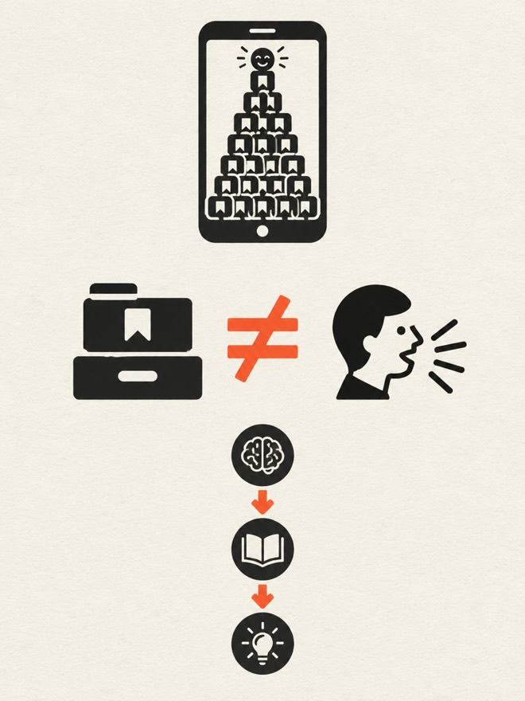</p>
<p><sub>"收藏≠学会" · 阶梯式布局，图上文字模型直出、逐字校对 · <a href="showcase/xiaoma-gen-infographic/">提示词</a></sub></p>

### xiaoma-gen-cover · 文章封面

三创意方向（直接冲击 / 氛围 / 信息可视化）各出一稿，平台规格锁定，主体必须落在缩略图安全区内，交付带标题的成品——短标题模型直出，位置要求严格时走底图 + 排版叠字。

<p>
  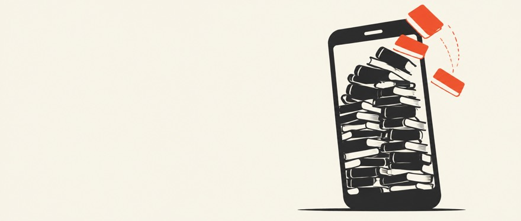
  
  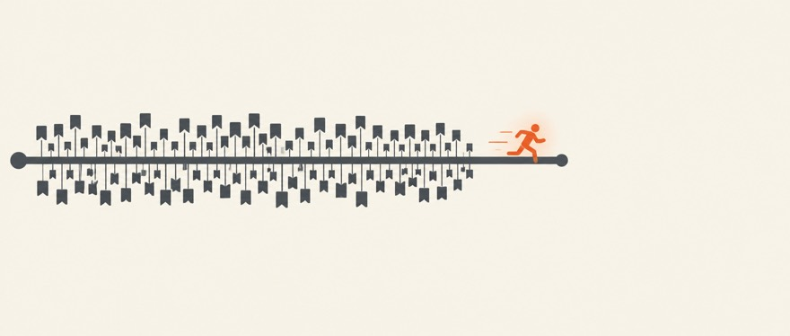
</p>
<p><sub>同一篇文章的三个创意方向：A 直接冲击 · B 氛围 · C 信息可视化（A、C 为底图 + 排版叠字，<a href="showcase/xiaoma-gen-cover/">看源文件</a>）</sub></p>

### xiaoma-gen-video · 视频生成编排

导演式提示词（场景总述 + Timeline 时间轴）→ 低价档试参数 → 确认 → 正式档出片。逐镜质检，失败只重出该镜。

<p></p>
<p><sub>样片帧 · <a href="showcase/xiaoma-gen-video/sample-01.mp4">看完整 10 秒 mp4</a>（书堆上的橘猫 · seed-2-mini 档）</sub></p>

### xiaoma-video-script · 短视频脚本

3 秒钩子三选一 → 口播逐字稿（读出声不别扭）→ 分镜表（镜号/时长/画面/台词/BGM）。逐字稿和分镜可以排成一张提词卡：选中的钩子高亮，每段左边时间码、中间逐字稿（红色下划线 = 重读，「／」= 停半拍），右边这一段的画面、字幕和音效，拿着就能录。

<p>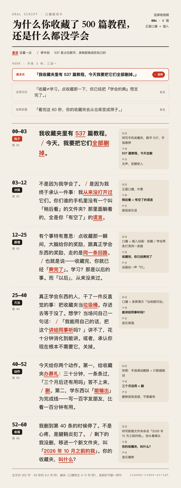</p>

> 537 是占位数字，录制前换成你自己的。[完整脚本 + 分镜表 →](showcase/xiaoma-video-script/example-01.md)

### xiaoma-gen-ui · 网站 UI 设计

**指定技术栈保证 oneshot 品质**：shadcn/ui（Nova 风格）组件 · Lucide 图标 · Motion 动画 · react-resizable-panels 布局 · dnd-kit 拖拽 · Zustand 状态——同类能力只装一个库，全站一套设计语言。

写任何区块前先查对应参考源（导航→navbar.gallery，CTA→cta.gallery，布局→bentogrids.com，微交互→60fps.design……共 10 个），然后进入 **awwwards 级自检循环**：真实跑起来截图，先过硬指标（移动端无横滚 / 对比度 / Lighthouse），再按 Design 40% / Usability 30% / Creativity 20% / Content 10% 打分，任何一维不到 9 分就修了重评，最多三轮。

> 对你的 Agent 说："用 xiaoma-gen-ui 做一个深色高级感的 AI 产品落地页"——下面就是这句话跑出来的结果（虚构产品「墨隙」，三轮自检后 Lighthouse 移动端 Performance 98 / Accessibility 100）：

<p>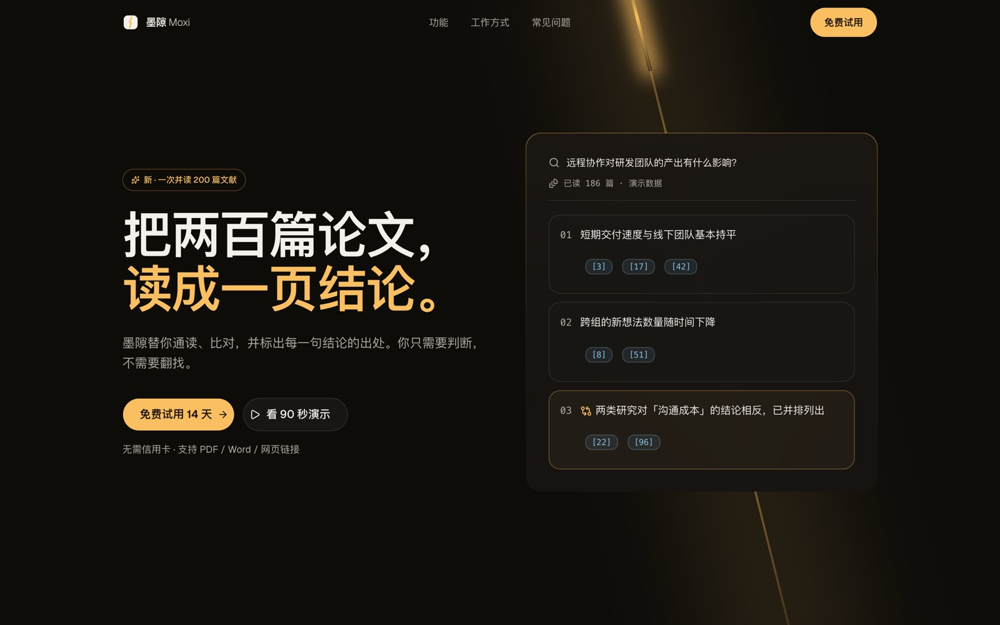</p>
<p>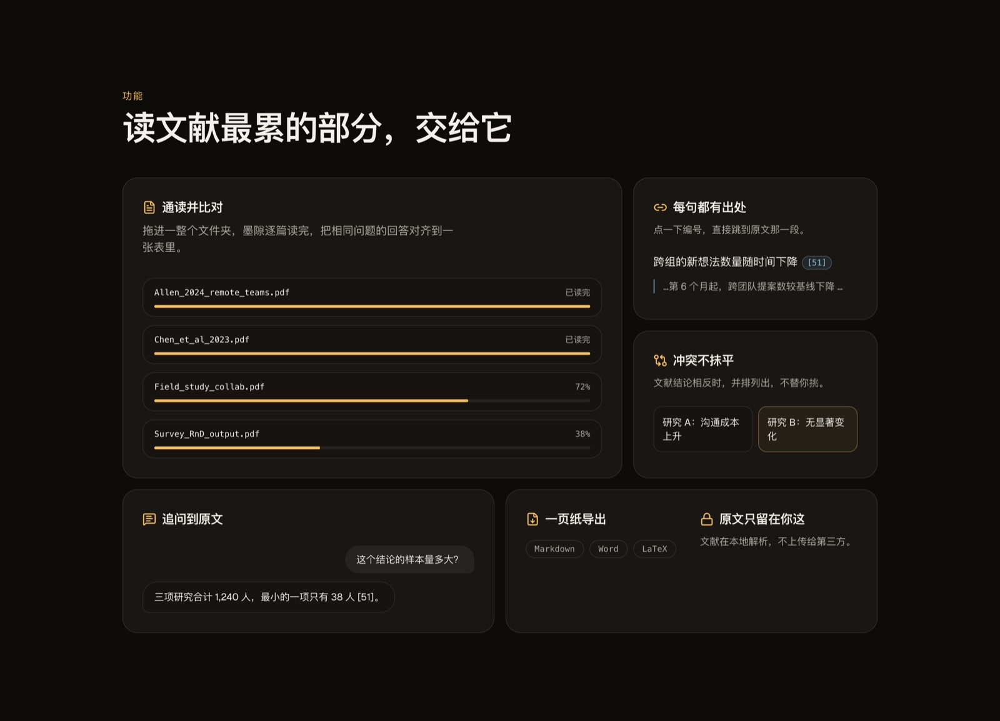</p>

> [设计 tokens、三轮自检记录、移动端截图与源码 →](showcase/xiaoma-gen-ui/README.md)

---

## 📚 创作知识总览

各技能背后的创作知识（171 条短剧样本、30 条代码动效样本的拆解规律，17 片种编导卡，剪辑、复刻、产线、写作、设计方法论）汇成一个单文件网页：克隆后打开 [`docs/knowledge/index.html`](docs/knowledge/index.html)。改了任何 reference 后运行 `python3 tools/build_portal.py` 重新生成。

---

## 🤝 贡献

欢迎提交新技能和改进！每个技能是一个独立目录（`SKILL.md` + 参考资料），本仓库提供结构自检工具。详见 [CONTRIBUTING.md](CONTRIBUTING.md)。

## License

MIT © 2026 小马。部分内容改写自第三方开源项目，见 [THIRD_PARTY_NOTICES.md](THIRD_PARTY_NOTICES.md)。
