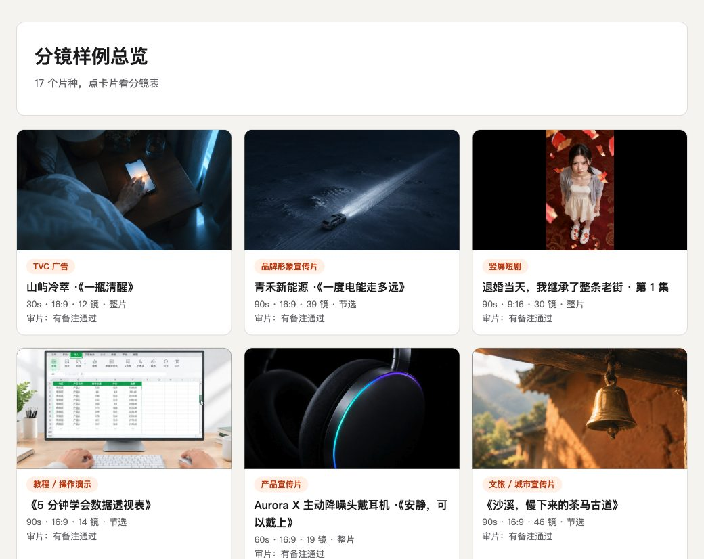
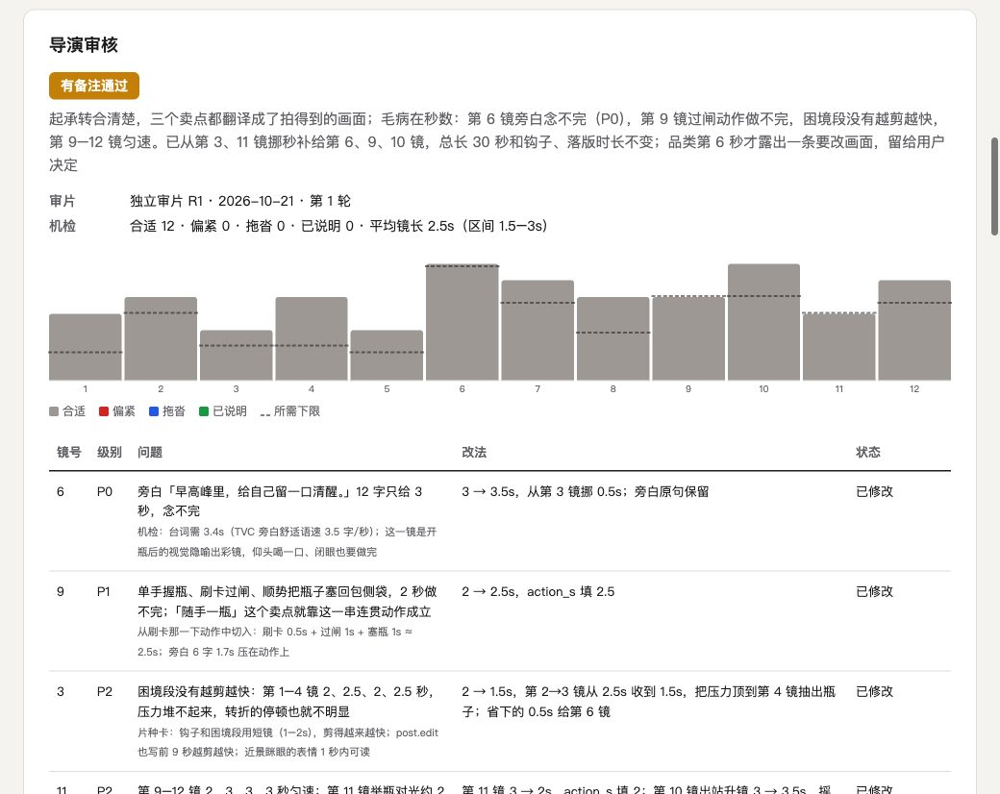
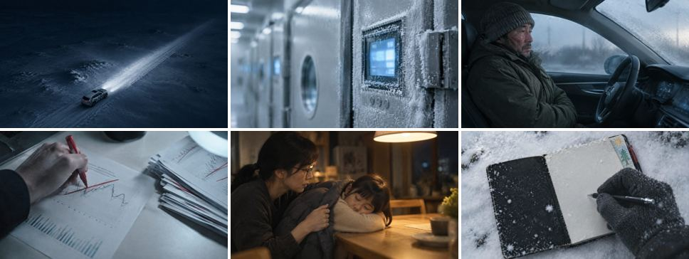
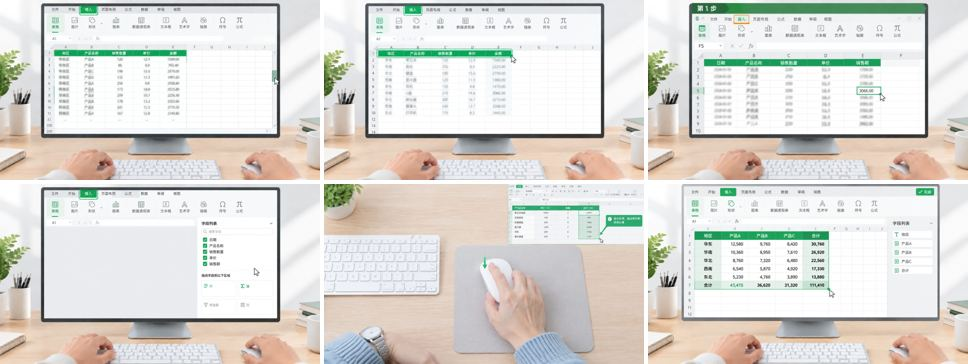
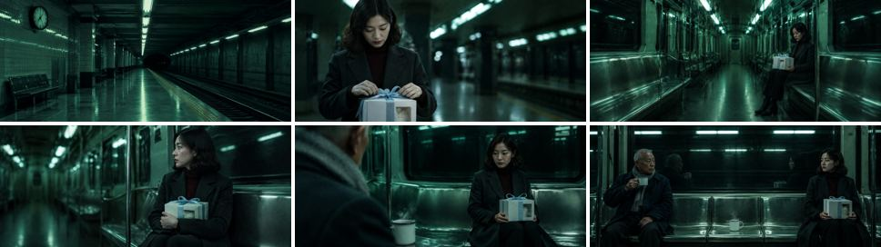
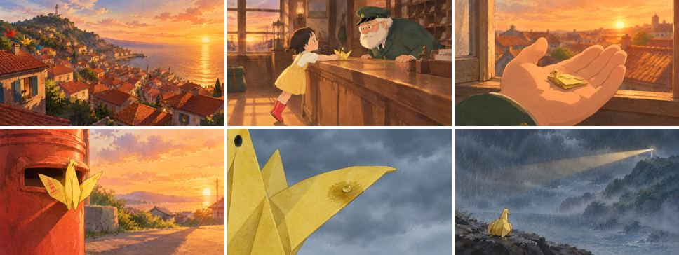
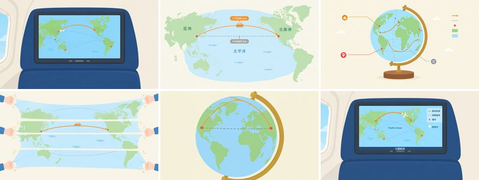

# 小马导演 xiaoma-director

给 AI agent 用的编导分镜 skill。你说一句「我想做个视频」，它先判断这是什么片子，再按这个片种的结构、节奏和镜头语言写出专业分镜表；出图之前过一道**导演审核**，逐镜判断秒数是拖沓还是太赶；最后用你配置的生图模型给每一镜出分镜图，生成一个可以直接发给别人的单文件 HTML。

**[在线看 17 个片种的分镜表样例 →](https://crawfordxx.github.io/xiaoma-director/samples/index.html)**

[](https://crawfordxx.github.io/xiaoma-director/samples/index.html)

## 能做什么

- **17 个片种**：TVC 广告、品牌宣传片、竖屏短剧、教程、产品宣传片、文旅宣传片、微电影、动画短片、知识科普、MG 动画、达人口播带货、纪录片、MV、Vlog、预告片 / 游戏 PV、片头开场片、活动纪实。每个片种一张「片种卡」，写清结构模板、节奏基准、招牌镜头、扩展列、画风、声音要点和常见坑
- **向顶尖作品学**：每张片种卡都按国内外公认的好片子拉片实测校过，卡末列出 4–6 部「顶尖范本」和它们怎么排镜头，写分镜时先挑一部最接近的照着排，见下文
- **先定片种**：需求说清了就直接匹配并说明理由；说不清就分两层问（先问大类，再问具体片种），还定不下来就问三个问题收敛，不硬猜
- **专业分镜表**：镜号、时间码、景别 · 角度 · 运镜、画面内容、台词 / 旁白 / 字幕、音效 / 音乐、转场、叙事目的，加上片种自己的扩展列（比如 TVC 的「产品露出」、短剧的「情绪钩子」、MV 的「歌词」和「卡点」）。时间码由脚本按每镜时长算出，不会断档
- **导演审核**：出图之前先审节奏，见下文
- **分镜图**：角色、产品、场景先出设定图，后面的镜头带着设定图出图，跨镜保持一致；改了分镜重跑，只重出变了的镜头
- **视频出片（可选）**：配置视频模型后，分镜逐镜生成视频片段（四种后端：OpenAI 兼容、任务轮询、结构化导演参数、自定义命令），先干跑看提示词再真出片；出片后七维质检，修复优先「局部修改」而不是整镜重出。17 个片种哪些适合生成、哪些该实拍混合，见 [`references/video-pipeline.md`](skills/xiaoma-director/references/video-pipeline.md) 的路线筛选表
- **单文件 HTML**：分镜图内嵌，宽屏是表格，窄屏自动变卡片，可以直接打印成 A4 横版

## 导演审核



两层：

1. **节奏机检**（`review.py`）：每镜先算「所需下限」，取四项里最长的：看清画面（按景别，大远景 3 秒到大特写 0.8 秒）、念完台词（字数 ÷ 片种舒适语速，英文单词按音节算）、读完字幕（每秒 9 字）、动作做完（编导估算的 `action_s`）。实际时长短于下限判**偏紧**，长于「下限 + 片种余量」判**拖沓**；另外提醒全片整体偏快偏慢、节奏匀速、钩子太晚。有意为之的写 `pace_note` 说明理由
2. **导演审片**：由一个没参与创作的审片人（独立子代理）按 [`director-review.md`](skills/xiaoma-director/references/director-review.md) 逐镜判断规则抓不到的问题：刺激性台词后有没有反应镜头、动作做没做完就切走、有没有重复信息、情绪顶点后有没有降温、有没有快慢变化。每条意见写清镜号、症状、证据、改法和严重度，结论分「通过 / 有备注通过 / 退回修改」，最多改 3 轮

每个片种的节奏参数（平均镜长区间、语速、余量、无台词镜停留上限、钩子时限）都用顶尖范本校过：取值让好片子被机检误判的镜头不超过一成。片子属于卡里的子类型（竖屏短版、一镜到底、长版）时，用 `project.asl`、`project.hook` 覆盖片种值。

审核放在出图之前：改秒数、改台词不用重出图，只有拆镜、并镜、改画面才要补图。审核标准参考了 Walter Murch 的剪辑六原则、镜头时长与景别的统计研究、Netflix 中文字幕规范、多个开源分镜 skill 的审核规则，以及 B 站和抖音上剪辑博主的教程，出处见 [`director-review.md`](skills/xiaoma-director/references/director-review.md) 末尾。

## 向顶尖作品学：拉片实测

每个片种挑 4–7 部国内外公认的好片子当范本，依据是大奖（戛纳狮、One Show、D&AD、奥斯卡、金马等）、行业公认的导演和工作室、平台头部播放、被反复拉片教学。比如 TVC 看 Ridley Scott《1984》、Iñárritu《Write the Future》，纪录片看 BBC《地球脉动 II》、陈晓卿《舌尖上的中国》，片头看 Saul Bass、Kyle Cooper《七宗罪》、Patrick Clair《真探》，科普看 Kurzgesagt、3Blue1Brown、何同学，MV 看 Hiro Murai《This Is America》、Dave Meyers《HUMBLE.》。

- **读教程**：B 站、抖音、小红书、知乎、YouTube、TikTok、Reddit 上的拉片、分镜拆解、导演幕后，加上 Art of the Title、StudioBinder、No Film School、获奖案例页和导演访谈
- **实测**：范本下载到本机，用 PySceneDetect 切镜、抽帧人工复核，量平均镜长、镜长分布、前 3 秒切几刀、钩子在第几秒；语速用字幕时间轴或本机 Whisper 转写来量。量完即删视频，只留数字
- **落到卡片**：多源一致或有实测的结论才改进片种卡，单一来源的写成「也可以」；每张卡末尾加「顶尖范本」表，写每部片子怎么排镜头

几个和直觉不一样的发现：头部文旅片哪怕主题是「慢」，平均镜长也只有 1.3–2 秒，慢感靠画面里的慢而不是拉长镜头；国内平台头部纪录片正片平均镜长 2.5–2.8 秒，比国外观察型（4–9 秒）快一倍；顶尖 MV 和 aftermovie 的切点并不逐拍卡，节拍感靠画内动作；预告片三幕镜长依次约 1.6–2.3 → 1.2–2.1 → 0.9–1.5 秒。

全部实测数据、参数取值依据和 250 条来源见 [`references/benchmarks.md`](skills/xiaoma-director/references/benchmarks.md)。

## 安装

用 [skills](https://skills.sh) 命令行：

```bash
npx skills add crawfordxx/xiaoma-director
```

或者手动：

```bash
git clone https://github.com/crawfordxx/xiaoma-director.git
ln -s "$(pwd)/xiaoma-director/skills/xiaoma-director" ~/.claude/skills/xiaoma-director   # Claude Code
```

其他支持 Agent Skills 的工具（Codex 等），把 `skills/xiaoma-director` 放进它们的 skills 目录即可。

依赖：Python 3.9+、Pillow（`pip install pillow`）。

## 配置出图模型

出图模型由你自己配置，全部用环境变量。不配置也能用：分镜表、导演审核、HTML 都照常生成，只是不带分镜图。

**GPT Image（OpenAI 官方）**

```bash
export IMAGE_API_KEY=sk-...          # 没设时会读 OPENAI_API_KEY
export IMAGE_MODEL=gpt-image-1       # 默认 gpt-image-1
export IMAGE_QUALITY=low             # low / medium / high，分镜草图用 low 就够
```

**OpenAI 兼容网关**（国内中转、聚合网关等）

```bash
export IMAGE_API_BASE=https://你的网关地址
export IMAGE_API_KEY=...
export IMAGE_MODEL=gpt-image-2       # 网关上的模型名
export IMAGE_SIZES=exact             # 网关支持任意尺寸时用 exact，构图更准；默认 standard
```

`IMAGE_SIZES=standard` 时只请求 1024x1024、1536x1024、1024x1536 三种尺寸，出来后再按画幅居中裁切，官方接口都能用。

**Midjourney 或其他没有标准接口的模型**

Midjourney 没有官方 API。用你自己的第三方接口或代理服务写一个出图脚本，再这样接进来：

```bash
export IMAGE_BACKEND=command
export IMAGE_CMD='python3 /path/to/my_mj.py --prompt {prompt} --ar {aspect} --refs {refs} --out {out}'
```

脚本约定：
- 占位符：`{prompt}` 提示词、`{size}` 请求尺寸、`{aspect}` 画幅（如 16:9）、`{out}` 输出文件路径、`{refs}` 设定图本地路径（逗号分隔，可能为空）
- 把图写到 `{out}`（扩展名随意），成功退出码 0，失败非 0 并把原因打到 stderr
- 命令不经过 shell，提示词里的内容不会被当成命令执行
- 提示词是中文；Midjourney 用英文效果更好，可以在脚本里先翻译。设定图要做角色参考（`--cref`）时，需要先把 `{refs}` 里的本地图上传成公网链接

本仓库只实测过 OpenAI 兼容接口；Midjourney 脚本需要按你用的服务自己实现。

**预估费用**：设 `IMAGE_PRICE=每张价格`，`frames.py --dry-run` 会给出预估。

## 配置视频模型

和出图一样全走环境变量，四种后端，默认**干跑**（只产出每镜提示词，不联网不花钱）：

```bash
# 后端一：OpenAI 兼容接口（URL 在回复文本里）
export VIDEO_BACKEND=chat VIDEO_API_BASE=… VIDEO_API_KEY=… VIDEO_MODEL=…

# 后端二：任务型网关（提交任务后轮询）
export VIDEO_BACKEND=task VIDEO_API_BASE=… VIDEO_API_KEY=… VIDEO_MODEL=…

# 后端三：结构化网关（Key 鉴权 + 导演参数枚举：运镜/镜头/光圈/调色板）
export VIDEO_BACKEND=structured VIDEO_API_BASE=… VIDEO_GW_ID=… VIDEO_GW_SECRET=… VIDEO_GW_ENDPOINT=…

# 后端四：自定义命令（占位符 {prompt} {out} {ratio} {duration}）
export VIDEO_BACKEND=command VIDEO_CMD='你的封装脚本 {prompt} {out}'
```

- `VIDEO_DRY_RUN` 默认 `1`；设 `0`（或 `video_render.py --live`）才真出片
- 出片：`python3 $SD/video_render.py storyboard/<slug>/storyboard.json`，质检：`video_qa.py`（七维打分，repair 判决给「局部修改」建议）
- 提示词里的运镜词条会被自动映射成结构化枚举（对照表见 [`references/camera-vocab.md`](skills/xiaoma-director/references/camera-vocab.md)），对不上的交给端点自动导演

## 用法

装好以后直接跟 agent 说需求：

- 「给我的冷萃咖啡拍一条 30 秒广告」→ 直接按 TVC 做
- 「这是我短剧第一集的剧本，帮我出分镜」→ 按竖屏短剧做
- 「我想做个视频」→ 先问你要做什么片

流程：需求门定片种 → 补齐规格 → 读片种卡 → 写 `storyboard.json` → 校验 → **导演审核** → 出图 → 渲染 HTML → 交付前自检。也可以单独跑脚本：

```bash
SD=~/.claude/skills/xiaoma-director/scripts
python3 $SD/validate.py storyboard.json            # 结构、时长、景别、台词时长、扩展列
python3 $SD/review.py   storyboard.json            # 节奏机检
python3 $SD/frames.py   storyboard.json --dry-run  # 看要出几张图
python3 $SD/frames.py   storyboard.json            # 出图
python3 $SD/render.py   storyboard.json            # 生成同目录的 storyboard.html
```

## 示例：17 个片种

下面每个样例都是这个 skill 实际做出来的：分镜由 agent 按片种卡写成，经过节奏机检和独立审片，分镜图用 GPT Image 生成。点图片或链接看完整的 HTML 分镜表。品牌、产品、人物、歌曲都是虚构的。

### 01 · TVC 广告：山屿冷萃 ·《一瓶清醒》

30s · 16:9 · 12 镜 · 整片 · 导演审核：有备注通过（6 条意见） · [在线看分镜表](https://crawfordxx.github.io/xiaoma-director/samples/01-tvc/storyboard.html)

> 城市早高峰把人挤成一团，拧开一瓶冷萃的那一刻，世界凉下来、静下来，她被从人群里「拎」了出来。

[](https://crawfordxx.github.io/xiaoma-director/samples/01-tvc/storyboard.html)

### 02 · 品牌形象宣传片：青禾新能源 ·《一度电能走多远》

90s · 16:9 · 39 镜 · 节选 · 导演审核：有备注通过（8 条意见） · [在线看分镜表](https://crawfordxx.github.io/xiaoma-director/samples/02-brand-film/storyboard.html)

> 一个电池工程师在零下三十多度的雪原上记了十一年数字，只为回答一个问题：一度电，能走多远。

[](https://crawfordxx.github.io/xiaoma-director/samples/02-brand-film/storyboard.html)

### 03 · 竖屏短剧：退婚当天，我继承了整条老街 · 第 1 集

90s · 9:16 · 30 镜 · 整片 · 导演审核：有备注通过（13 条意见） · [在线看分镜表](https://crawfordxx.github.io/xiaoma-director/samples/03-short-drama/storyboard.html)

> 订婚宴上被准婆婆当众退婚、拿五十万打发，裁缝外婆留下的一只铁盒却让姜念成了整条老街的主人——而周家今天要签的，正是这条街。

[](https://crawfordxx.github.io/xiaoma-director/samples/03-short-drama/storyboard.html)

### 04 · 教程 / 操作演示：《5 分钟学会数据透视表》

90s · 16:9 · 14 镜 · 节选 · 导演审核：有备注通过（19 条意见） · [在线看分镜表](https://crawfordxx.github.io/xiaoma-director/samples/04-tutorial/storyboard.html)

> 先让观众看到两百行明细一下变成五行汇总，再手把手走完「点开、拖三次」，在这一段结尾亲手做出和开头一模一样的那张表。

[](https://crawfordxx.github.io/xiaoma-director/samples/04-tutorial/storyboard.html)

### 05 · 产品宣传片：Aurora X 主动降噪头戴耳机 ·《安静，可以戴上》

60s · 16:9 · 19 镜 · 整片 · 导演审核：有备注通过（10 条意见） · [在线看分镜表](https://crawfordxx.github.io/xiaoma-director/samples/05-product-promo/storyboard.html)

> 一道沿着耳罩划过的极光之后，Aurora X 在夜航机舱里把轰鸣和哭闹抹平，把一把大提琴的琴弦送到耳边。

[](https://crawfordxx.github.io/xiaoma-director/samples/05-product-promo/storyboard.html)

### 06 · 文旅 / 城市宣传片：《沙溪，慢下来的茶马古道》

90s · 16:9 · 46 镜 · 节选 · 导演审核：有备注通过（5 条意见） · [在线看分镜表](https://crawfordxx.github.io/xiaoma-director/samples/06-city-tourism/storyboard.html)

> 一个习惯按分钟过日子的上海人来到沙溪，被马铃、烤茶和一周一次的集市一点点调慢，第三天他把手机扣在了古戏台的石阶上。

[](https://crawfordxx.github.io/xiaoma-director/samples/06-city-tourism/storyboard.html)

### 07 · 微电影 / 剧情短片：末班地铁

90s · 2.39:1 · 14 镜 · 节选 · 导演审核：有备注通过（8 条意见） · [在线看分镜表](https://crawfordxx.github.io/xiaoma-director/samples/07-micro-film/storyboard.html)

> 生日夜被放鸽子的苏棠提着没拆的蛋糕坐上末班地铁，整节空车厢里，一个陌生老人偏偏坐到她正对面，倒了两杯热水，一杯留在身旁的空座上。

[](https://crawfordxx.github.io/xiaoma-director/samples/07-micro-film/storyboard.html)

### 08 · 动画短片：纸鹤邮差

60s · 16:9 · 12 镜 · 节选 · 导演审核：通过（4 条意见） · [在线看分镜表](https://crawfordxx.github.io/xiaoma-director/samples/08-animation/storyboard.html)

> 在信会折成纸鹤自己飞的海边小城，一只最小、最歪的纸鹤要把小女孩的信送上山顶灯塔，可暴雨就要来了，纸鹤一沾水就会散开。

[](https://crawfordxx.github.io/xiaoma-director/samples/08-animation/storyboard.html)

### 09 · 知识科普 / 解说：《为什么飞机航线是弯的》

90s · 16:9 · 28 镜 · 节选 · 导演审核：有备注通过（6 条意见） · [在线看分镜表](https://crawfordxx.github.io/xiaoma-director/samples/09-explainer/storyboard.html)

> 把观众在航线屏幕上见过的那条弯线当成谜题：先让直线和弯线比一比里程，再剥开地球仪看地图是怎么被拉变形的，最后用一根拉紧的线证明——弯的那条，才是最直的路。

[](https://crawfordxx.github.io/xiaoma-director/samples/09-explainer/storyboard.html)

### 10 · MG 动画 / 数据可视化：《一分钟看懂家庭光伏》

60s · 16:9 · 11 镜 · 整片 · 导演审核：有备注通过（5 条意见） · [在线看分镜表](https://crawfordxx.github.io/xiaoma-director/samples/10-motion-graphics/storyboard.html)

> 一颗金色光点从太阳出发，落到屋顶、钻进光伏板、穿过逆变器、点亮家里的灯，用不完的再沿电线流向电网——跟着它走一遍，就看懂了家庭光伏。

[](https://crawfordxx.github.io/xiaoma-director/samples/10-motion-graphics/storyboard.html)

### 11 · 达人口播 / 带货种草：轻榨 ·《通勤党的随身榨汁杯》

30s · 9:16 · 10 镜 · 整片 · 导演审核：有备注通过（4 条意见） · [在线看分镜表](https://crawfordxx.github.io/xiaoma-director/samples/11-creator-ad/storyboard.html)

> 她嘴上说「每天背着榨汁机上班」，手里掏出来的却是个巴掌大的杯子——跟着她从玄关走到工位，看这杯早饭是怎么在 30 秒里打出来的。

[](https://crawfordxx.github.io/xiaoma-director/samples/11-creator-ad/storyboard.html)

### 12 · 纪录片 / 人物纪实：《钟表铺的第四十年》

90s · 16:9 · 12 镜 · 节选 · 导演审核：通过（9 条意见） · [在线看分镜表](https://crawfordxx.github.io/xiaoma-director/samples/12-documentary/storyboard.html)

> 苏州老巷里一间九平米的钟表铺，周师傅修了四十年别人的时间；墙上还挂着几十只没人来取的钟，他一只也没扔。

[](https://crawfordxx.github.io/xiaoma-director/samples/12-documentary/storyboard.html)

### 13 · MV / 音乐短片：《海边的风》MV

60s · 16:9 · 20 镜 · 节选 · 导演审核：有备注通过（7 条意见） · [在线看分镜表](https://crawfordxx.github.io/xiaoma-director/samples/13-mv/storyboard.html)

> 他坐末班车回到海边小镇，院子里还晾着你那件白衬衫；风一直往海的方向吹，像要把没说出口的话送过去。

[](https://crawfordxx.github.io/xiaoma-director/samples/13-mv/storyboard.html)

### 14 · Vlog：《一个人去阿勒泰的第三天》

60s · 16:9 · 16 镜 · 节选 · 导演审核：有备注通过（9 条意见） · [在线看分镜表](https://crawfordxx.github.io/xiaoma-director/samples/14-vlog/storyboard.html)

> 阿勒泰第三天，房东说今天可能有雾；我七点摸黑出门爬上观景台，等太阳翻过山头，等雾从河谷里升起来。

[](https://crawfordxx.github.io/xiaoma-director/samples/14-vlog/storyboard.html)

### 15 · 预告片 / 游戏 PV：星槎 · 首曝 PV

90s · 2.39:1 · 30 镜 · 整片 · 导演审核：有备注通过（13 条意见） · [在线看分镜表](https://crawfordxx.github.io/xiaoma-director/samples/15-trailer-pv/storyboard.html)

> 三百年前，最后一艘驶向天河尽头的星槎没有回来；当吞噬星辰的巨鲲压向港口，年轻槎师沈渡调转船头，迎着它驶向那条无人归来的航线。

[](https://crawfordxx.github.io/xiaoma-director/samples/15-trailer-pv/storyboard.html)

### 16 · 片头 / 活动开场片：2026 开发者大会 · 主会场开场片《从一行开始》

30s · 16:9 · 14 镜 · 整片 · 导演审核：有备注通过（5 条意见） · [在线看分镜表](https://crawfordxx.github.io/xiaoma-director/samples/16-opening-title/storyboard.html)

> 全场灯暗，大屏中央一个光标闪了两下，敲出「hello, world」；这一行字坠落成光，长成一座代码之城，最后收回成大会的标志。

[](https://crawfordxx.github.io/xiaoma-director/samples/16-opening-title/storyboard.html)

### 17 · 发布会 / 活动纪实：2026 城市半程马拉松 · 赛事回顾

90s · 16:9 · 24 镜 · 整片 · 导演审核：有备注通过（7 条意见） · [在线看分镜表](https://crawfordxx.github.io/xiaoma-director/samples/17-event-recap/storyboard.html)

> 从凌晨四点半空无一人的大道，到上午十点一个父亲冲过终点被女儿抱住：一场半马，被这座城记住的不只是冠军。

[](https://crawfordxx.github.io/xiaoma-director/samples/17-event-recap/storyboard.html)

## 目录结构

```
skills/xiaoma-director/       skill 本体（安装的就是这个目录）
  SKILL.md                    总控流程与片种速查
  genres/                     17 张片种卡
  references/                 镜头语言、字段说明、出图提示词、导演审片标准、交付自检、顶尖范本实测与来源
  scripts/                    validate / review / frames / render 及出图后端
samples/                      17 个片种样例（storyboard.json、分镜图、HTML）
tests/                        pytest
```

## 开发

```bash
pip install pillow pytest
pytest tests -q
```

## 致谢

片种卡和审核标准提炼了下面这些开源项目和教程里的方法，文字均为重写：

- 开源 skill：[Shanyin-ai/shanyin-director-master](https://github.com/Shanyin-ai/shanyin-director-master)、[zhlmi/script-forging](https://github.com/zhlmi/script-forging)、[anyhui/video-storyboard-gen-skill](https://github.com/anyhui/video-storyboard-gen-skill)、[isjiamu/jiamu-skills](https://github.com/isjiamu/jiamu-skills)、[OYYH-Apple/video-storyboard-generator](https://github.com/OYYH-Apple/video-storyboard-generator)、[zenstory-ai/drama-skills](https://github.com/zenstory-ai/drama-skills)、[eternityspring/shuohao-skills](https://github.com/eternityspring/shuohao-skills)、[tomatoparkdao/omniailab-ai-director](https://github.com/tomatoparkdao/omniailab-ai-director)、[zyz254009-crypto/script-to-shootable-storyboard](https://github.com/zyz254009-crypto/script-to-shootable-storyboard)、[lixiaoxiao9888-create/manju-laoli-skill](https://github.com/lixiaoxiao9888-create/manju-laoli-skill)、[HeyChengC/vibe-knowledge-film](https://github.com/HeyChengC/vibe-knowledge-film)、[feicaiclub/video-spec-builder](https://github.com/feicaiclub/video-spec-builder)、[calesthio/generative-media-skills](https://github.com/calesthio/generative-media-skills)、[62656456/ai-film-skills](https://github.com/62656456/ai-film-skills)、[aicontentskills/ai-video-storyboard-skill](https://github.com/aicontentskills/ai-video-storyboard-skill)、[inference-sh/skills](https://github.com/inference-sh/skills)
- 剪辑理论：Walter Murch《In the Blink of an Eye》、Karel Reisz《电影剪辑技巧》、Edward Dmytryk 剪辑原则；镜头时长统计（Cutting 等）；Netflix 简体中文字幕规范
- B 站和抖音的剪辑教程：幕后玩家Stage、Director鹤唳云端、映美、电影裁缝Bryan、壹帧影视冬冬、阿次的寶藏片場、郭爱疯、董肯特等
- 顶尖范本拉片：各片种范本的导演、创作者和拆解作者，以及 Art of the Title、StudioBinder、No Film School 等资料站，逐条列在 [`benchmarks.md`](skills/xiaoma-director/references/benchmarks.md)。实测只为研究，视频不分发，卡片里只写重新归纳的规则和数字

## License

[MIT](LICENSE)
