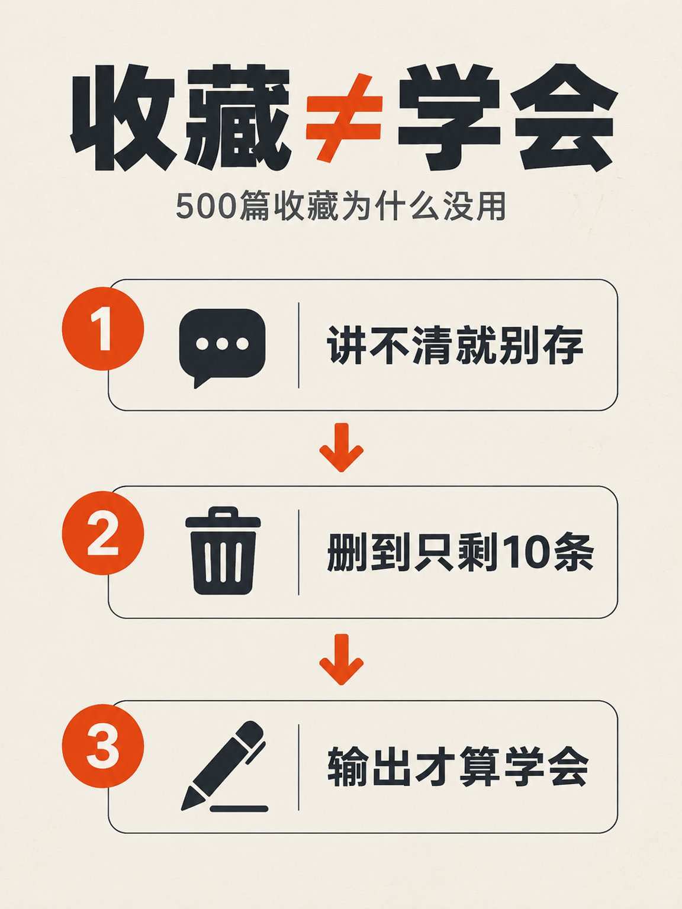

# gen-infographic 案例：收藏≠学会

阶梯式布局，3:4。图上 5 段文字（标题、副标题、3 个模块小标题）全部由模型直出，逐字校对通过；第一版标题旁有污渍，按规则重出一次。



## 提示词

```
竖版知识信息图，3:4，阶梯式布局，米白纸纹理底色，深炭黑扁平图形，橘红色作唯一强调色，充足留白，编辑设计感。
顶部：超大粗黑无衬线标题 "收藏≠学会"，其中 "≠" 为橘红色；标题下方一行小号深灰副标题 "500篇收藏为什么没用"。
下方三个从上到下的台阶模块，每个模块左边一个橘红圆形序号，右边一个简洁图标和一行粗体小标题：
模块1 图标是一个对话气泡，小标题 "讲不清就别存"；
模块2 图标是一个垃圾桶，小标题 "删到只剩10条"；
模块3 图标是一支笔，小标题 "输出才算学会"。
模块之间用橘红色向下箭头连接。render all text exactly as written, no other text, 3:4 aspect ratio
背景干净无污渍。
```
