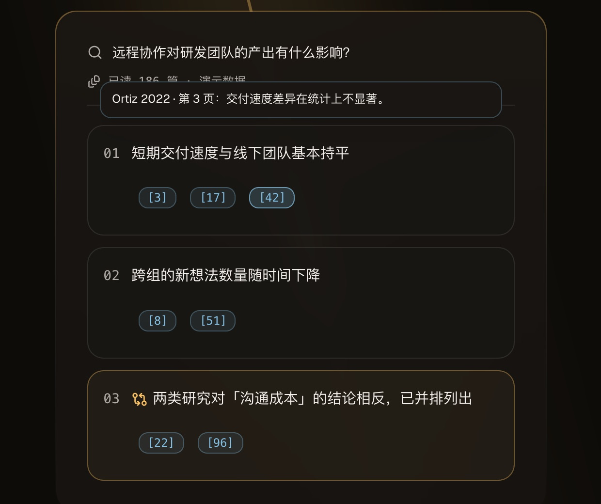
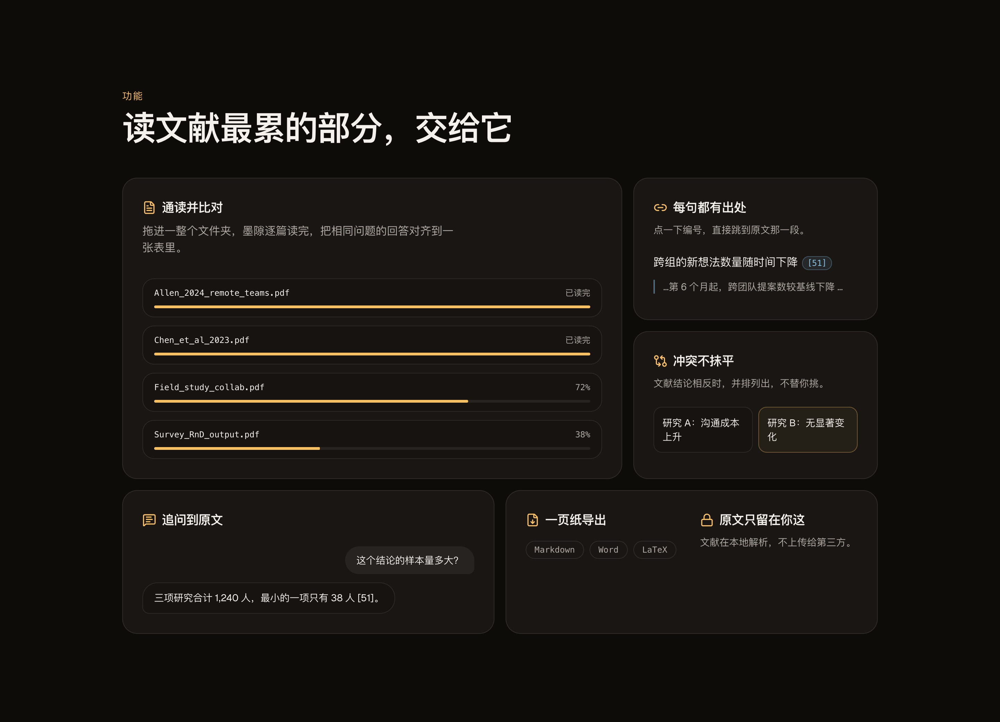
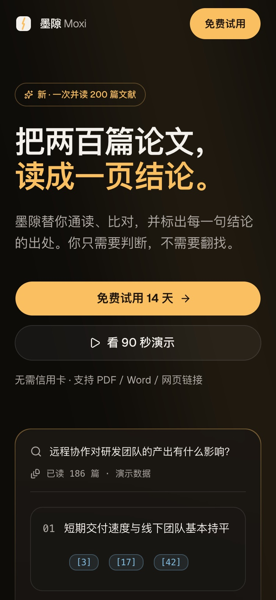
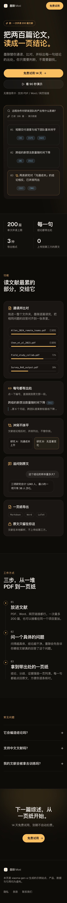

# xiaoma-gen-ui 示例：墨隙 Moxi 落地页

> 对 Agent 说：「用 xiaoma-gen-ui 做一个深色高级感的 AI 产品落地页」。下面是按技能 Pipeline 一步步走出来的结果，产品、数据与引用均为虚构。源码在 [`examples/moxi-landing/`](examples/moxi-landing/)。

## Step 1 · 设计 brief

给研究生和分析师用的 AI 文献助手，**唯一转化目标：免费试用**。调性三个词：深色、克制、有光。

## Step 2 · 设计语言（先 tokens，后组件）

| token | 值 | 用途 |
|---|---|---|
| `--background` | `oklch(0.155 0.006 70)` | 带一点暖的墨色，避免纯黑的塑料感 |
| `--glow` / `--primary` | `oklch(0.84 0.13 78)` | 琥珀色的光，全站唯一强调色 |
| `--cite` | `oklch(0.78 0.08 235)` | 冷蓝，只用来标出处 |
| 字体 | Geist + 系统中文字体栈 | 中文不加载字体文件，首屏不被拖慢 |

组件里只从 tokens 取值。第一轮里导航栏写了两个 oklch 字面值，自检时改成了 token 底色加透明度渐显。

## Step 3–6 · 区块与动画

导航 → Hero（左文案、右结论卡）→ 规格条 → Bento 功能网格 → 三步流程 → FAQ → CTA → 页脚。

- **记忆点一：光缝**。品牌叫「墨隙」，首屏就是墨色里裂开的一道光，一团光沿缝缓缓下行，穿过结论卡背后
- **记忆点二：出处可摸**。悬停或用键盘聚焦结论卡上的引用编号，在这一行上方弹出原文摘录，「每句都有出处」不用靠文案说

- 动画都有目的：入场依次出现、阅读进度条填满、三步流程的进度线随滚动填满、卡片悬停时轻微上浮；`prefers-reduced-motion` 开启时自动关掉位移动画

## Step 7 · 品质自检（三轮）

**硬指标（第三轮终测）**

| 项 | 结果 |
|---|---|
| 375px 宽横向滚动 | 无（scrollWidth = 375） |
| 触控目标 ≥ 44px | 全部达标（第一轮有 4 个不达标，已修） |
| 控制台报错 | 0（桌面 / 移动） |
| Lighthouse 移动端 | Performance 98 · Accessibility 100 · Best Practices 100 |
| LCP / TBT / CLS | 2.0s / 0ms / 0 |

**评分**

| 轮次 | Design | Usability | Creativity | Content | 改了什么 |
|---|---|---|---|---|---|
| 1 | 7.5 | 8 | 6.5 | 8.5 | 首屏右半边空、光缝像一道划痕、「工作方式」右侧大片空白、4 个触控目标不足 44px |
| 2 | 9 | 9 | 8.5 | 9 | Hero 改两栏、光缝加粗加流光、工作方式改左标题吸顶；还剩：光缝在小屏斜穿正文，记忆点只有一个 |
| 3 | 9 | 9 | 9 | 9 | 小屏只留柔光；新增引用悬停看原文 |

如实标注：Bento 网格的排法本身比较常规，右下角「导出 / 本地」那格信息偏少。

## 移动端

  
  

[桌面端全页截图](screenshots/desktop-full.jpg)
