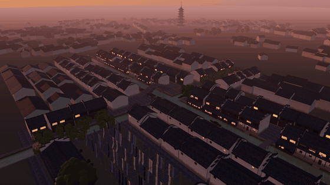

# xiaoma-opus3D

用 three.js **纯代码**搭一整片建筑场景（古镇、寺庙、园林、街区、景区……），交付一个**可以嵌进任何网页、能拖动旋转和缩放的 3D 模型**。不用任何 3D 模型、贴图或照片：几何、材质、纹理全部由代码生成。

这是一个 [Claude Code](https://claude.com/claude-code) skill。它把“多个 AI Agent 合力搭大场景”的流程固定下来：先出平面图、用脚本查碰撞，再派多个子 Agent 并行各建一块、各自截图对比，最后打包成可嵌入的交互模型并自动测试。

[](https://crawfordxx.github.io/xiaoma-opus3D/)

**在线演示：** <https://crawfordxx.github.io/xiaoma-opus3D/>（点上面的动图也能进。乌镇西栅，日落后灯笼刚亮的一刻。左键拖动旋转、滚轮缩放、右键平移）

> *English: a Claude Code skill that builds a whole procedural architectural scene in three.js — no models, textures or photos — by laying out a checked floor plan, dispatching parallel sub-agents per zone with screenshot reviews, and shipping an embeddable, orbit/zoomable interactive model (single self-contained HTML + a script-mount bundle). See the live Wuzhen demo above.*

## 70 秒漫游视频

同一个场景导出的漫游视频：10 个镜头，每个都从一个小物件的特写拉远（灯笼穗、船橹入水、望柱石刻、蓝印花布、河埠头、滴水瓦、花窗、柳枝、酒旗、逆光柳叶），最后落在朝西的航拍上。

https://github.com/user-attachments/assets/5d7a7a41-ed79-48b5-9c92-7c2dab6f9f89

看不到播放器的话：[打开 720p 版](https://crawfordxx.github.io/xiaoma-opus3D/wuzhen.mp4)（14 MB）。

## 交付物

| 文件 | 用法 |
|---|---|
| `dist/scene.html` | 自包含单文件（three.js 和场景全部内联），双击就能打开，或 `<iframe src="scene.html">` 嵌入 |
| `dist/scene-embed.js` | `<div data-scene='{"quality":"auto"}' style="height:540px"></div><script src="scene-embed.js"></script>` 挂到任意 div |
| `dist/embed-demo.html` | 两种嵌法的演示页 |

嵌入参数：`quality`（`auto` / `high` / `medium` / `low`，auto 会在帧率不够时自动降档）、`time`（光照时刻）、`hint`（关掉操作提示）。

## 安装

```bash
git clone https://github.com/crawfordxx/xiaoma-opus3D.git
ln -s "$PWD/xiaoma-opus3D/skills/xiaoma-opus3d" ~/.claude/skills/xiaoma-opus3d
```

需要：Node.js 22+、能跑 Playwright 的 Chromium（截图对比和自动测试用无头浏览器，macOS 上走 Metal GPU）。

## 怎么用

在 Claude Code 里直接说要做什么，比如：

> 用 three.js 做一个黄昏时的寺庙 3D 模型，要能嵌到网页里拖着看：主殿、五重塔、拱桥、莲花池、山门。

skill 会按 6 个阶段推进，每个阶段过了检查才进下一步：

| 阶段 | 做什么 | 验收 |
|---|---|---|
| 0 定参数 | 主题、范围、时段、区块清单、值得近看的细节、目标设备 | 你确认区块清单 |
| 1 平面图 | `layout.js` 是全项目唯一的坐标来源 | `check-layout` 查重叠、越界、路径 |
| 2 公共件 | 材质、参数化生成器、光照、施工规范 | 生成器先自测截图 |
| 3 分区施工 | 多个子 Agent 并行，各建一块，各自截图对比最多 3 轮 | 全部区块合起来截一轮 |
| 4 交互与画质 | 初始视角、视角限制、三档画质、NaN 黑帧回归 | 最远、最近、贴地都不穿帮 |
| 5 打包测试 | 单文件 HTML + script 版 + 演示页 | `test-viewer`：像素比 1 和 2 下测尺寸、拖动、缩放、平移、画质切换 |

另外可以按附录导出“特写 → 拉远”的漫游视频。

## 仓库结构

```
skills/xiaoma-opus3d/      skill 本体
  SKILL.md                 6 个阶段 + 每阶段的过关条件
  references/pitfalls.md   实战踩过的坑（NaN + bloom 整帧黑屏、Metal 优化掉 isnan、高像素比画布撑出容器……）
  references/              layout 约定、施工规范模板、镜头语法、例子
  assets/template/         项目骨架：场景核心、交互、画质分级、渐变天空、打包入口
  scripts/                 检查、截图、打包、交互测试、视频导出
examples/wuzhen/           完整实战：乌镇西栅，6 个区块、88 栋民居、4 座桥、3 条船
docs/                      在线演示（GitHub Pages）
```

## 乌镇例子

`examples/wuzhen/` 是这个 skill 的来源：先用 6 个并行 Agent 做了一段 70 秒视频，又改成了交互模型。

```bash
cd examples/wuzhen && npm install
npm run check      # 平面图检查
npm run build      # → dist/wuzhen.html、dist/wuzhen-embed.js、dist/embed-demo.html
npm run serve      # 然后打开 http://127.0.0.1:5173/viewer.html（开发版）
```

规模：240m × 160m 十字河口，88 栋民居、11 处水阁、4 座桥、3 条摇橹船、23 棵树、约 900 栋远景低模，约 700 万三角形。单文件 862 KB。

## License

[MIT](LICENSE)
