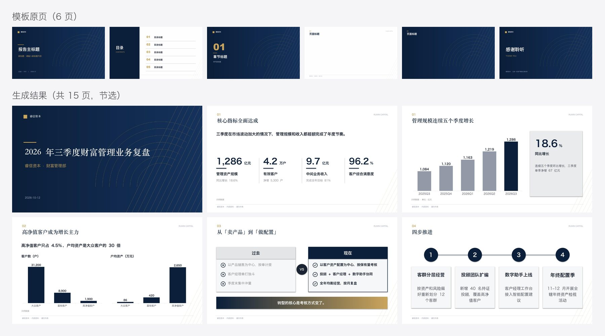
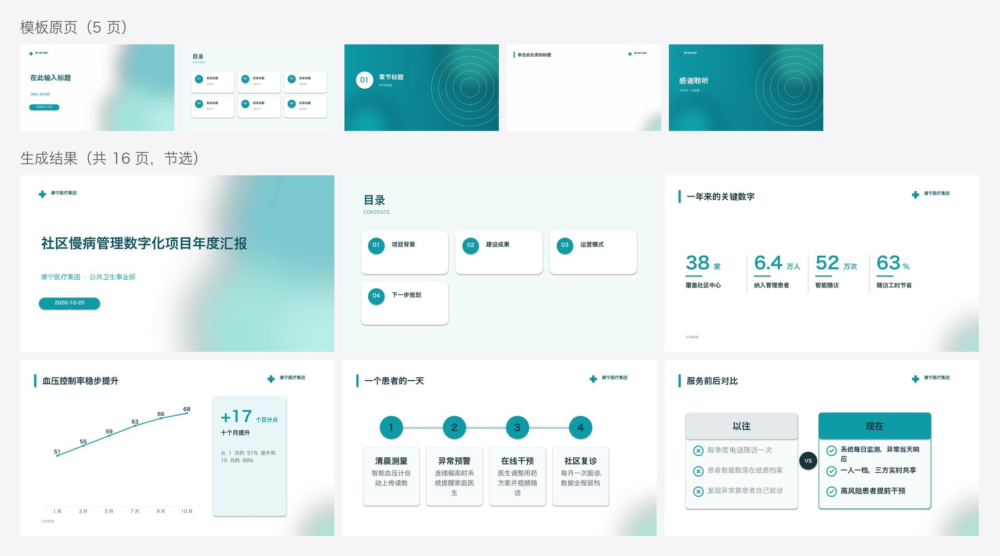
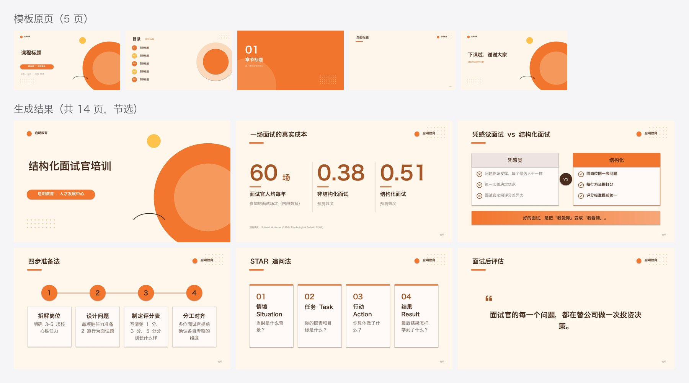
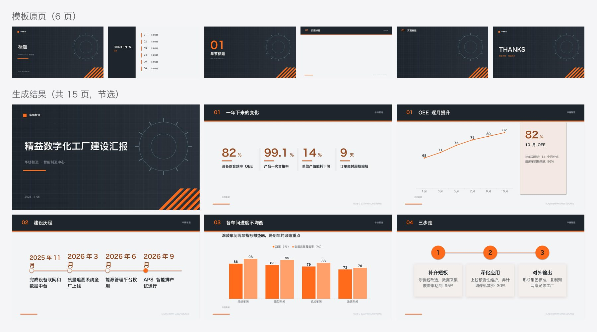
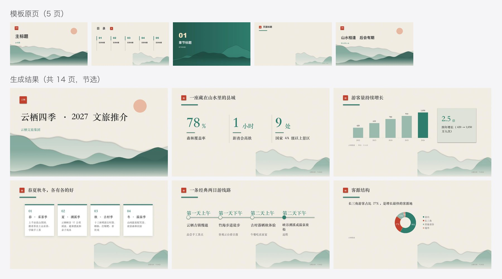
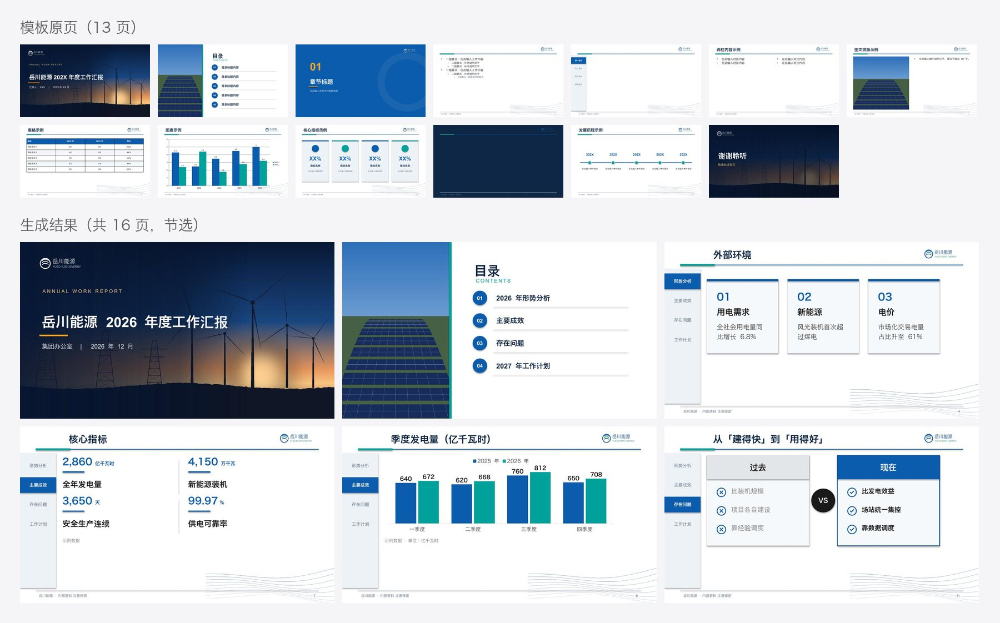
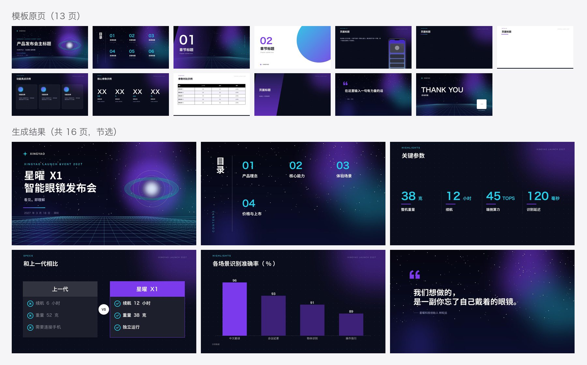
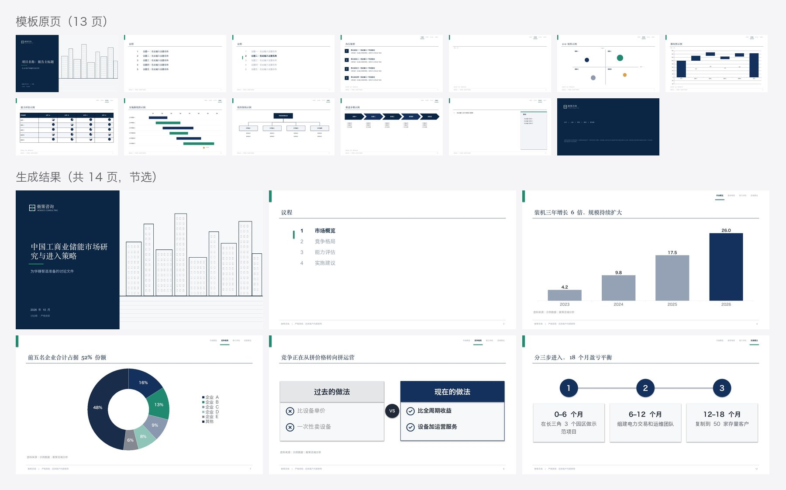
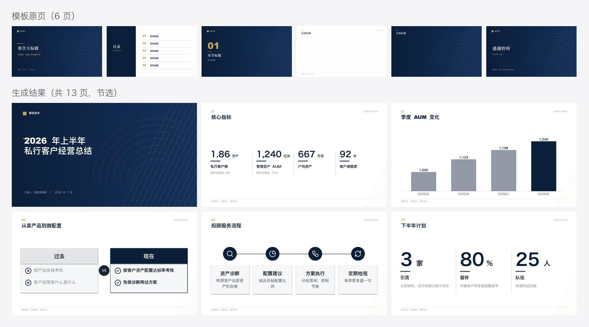

# xiaoma-ppt

> 把文档（Markdown、Word、txt、PDF……）套进你自己的 PPT 模板，生成「像模板本来就长这样」的可编辑 .pptx。任何能写代码的模型 / agent 都能用。
> Turn Markdown / Word / plain text into an editable .pptx that looks native to *your* corporate template — usable by any coding model or agent.

商用 PPT 的难点不是好看，是**和模板一致**：公司模板的颜色、字体、页眉页脚、logo、背景一样都不能动，内容还得排进模板留出来的地方。现有的 AI 做 PPT 工具大多是「换一套它自己的主题」，生成的东西拿到公司里没法用。

xiaoma-ppt 反过来：**版式从模板里找，颜色字体从模板里取，内容只在模板留出的地方画。**

## 例子

5 套行业模板（虚构品牌，代码生成，见 [`tools/make_templates.py`](tools/make_templates.py)）× 5 份行业 md。每张图上排是模板原页，下排是生成结果。

**金融 · 睿信资本《2026 年三季度财富管理业务复盘》** —— 海军蓝 + 金色，衬线标题，直角；装饰做在版式里


**医疗 · 康宁医疗《社区慢病管理数字化项目年度汇报》** —— 白 + 青绿，圆角；标题是占位符，目录条目是组合


**教育 · 启明教育《结构化面试官培训》** —— 奶油底 + 暖橙，大圆角、点阵装饰


**制造 · 华铸智造《精益数字化工厂建设汇报》** —— 石墨 + 安全橙，蓝图网格；内容页标题压在深色页眉带上


**文旅 · 云栖文旅《云栖四季 · 2027 文旅推介》** —— 宣纸 + 水墨远山 + 青绿朱砂；内容页右下角有山，内容自动避开


### 复杂模板

上面 5 套模板每套只有 5–6 页、结构干净。真实企业模板要乱得多，下面 3 套照着真实模板的复杂情况做（同样是虚构品牌、代码生成，见 [`tools/complex_*.py`](tools)），内容分别用 Word、Markdown、txt 给出。

**能源央企年度汇报 · 岳川能源**（13 页模板 + Word 内容）——全部用母版、版式和占位符搭成，页面上的标题占位符是空的；颜色字体全走主题引用；10 × 5.625 英寸的老尺寸；母版右下角有曲线装饰；内容页左侧有章节导航条（当前章节垫主题色）；深色页靠页面级配色映射反色；自带表格、图表、KPI 卡片、时间线等示例页


**科技发布会 · 星曜科技**（13 页模板 + Markdown 内容）——Keynote 导出式结构，所有东西都在页面上、没有占位符；全幅星空大图、渐变文字、描边空心数字、半透明玻璃卡片、竖排「目录」、旋转 90° 的英文；内容页右侧有出血的手机样机；有「左侧标题面板、右侧放内容」的页；自带金句页


**咨询研究报告 · 衡策咨询**（14 页模板 + GBK 编码的 txt 内容）——第一页是隐藏的「模板使用说明」；议程写在一个文本框里；章节页是「高亮当前议题的议程页」；内容页右上角有进度标签、底部有资料来源和页码；带 2×2 矩阵、瀑布图、哈维球表、甘特图、组织架构、箭头流程等示例页；有带右侧要点栏的版式；封底是免责声明


这些模板拆出来的问题都修进了引擎：
- 页面角色：隐藏页跳过，第一张没隐藏的页才是封面；免责声明封底认成结尾；模板自带的金句页直接拿来放引用；议程式章节页、左标题内容页都认得出。
- 导航：进度标签 / 章节导航条每页写上章节名，当前章用模板的高亮样子，高亮标记跟着移；段落式议程沿用模板的编号格式。
- 槽位：页码、页脚占位符不当槽位；位置继承自版式的占位符能正确调整；封面上的英文眉题（ANNUAL REPORT）不被当成副标题，章节页上的 CHAPTER ONE 跟着章节号变。
- 颜色和版面：主色不被渐变遮罩带偏；背景上的柔光不当成插画避开；带侧栏、带样机的窄版式不参与自动轮换；深色为主的模板默认用深色内容页。

每个例子目录里有：`content.md`（原始内容；复杂模板的 3 个例子是 `content.docx` / `content.md` / `content.txt`，转出来的 md 在 `work/content.converted.md`）→ `work/profile.md`（模板画像）→ `deck.json`（逐页规划）→ `out/deck.pptx`（成品，可在 PowerPoint / WPS / Keynote 里直接改）。图表都是原生图表，双击就能改数据。

## 它怎么做到的

**1. 拆模板（`inspect_template.py`）**
自动认出每一页是封面、目录、章节、内容还是结尾；哪些文本框是要填字的槽位（标题、副标题、序号、目录条目），哪些是品牌名和页脚（原样保留）；从模板实际用到的颜色里按面积找出主色辅色，读出字体和圆角风格。最后算出每张内容页的**内容安全区**：避开标题、logo、页脚，再把背景图渲染出来按像素找出插画（吉祥物、山水、齿轮）一并避开。

**2. 匹配内容（`convert.py` + `plan.py`）**
内容不是 md 时先转成 md（下表），转出来的 md 可以直接看、直接改。

| 格式 | 怎么认结构 |
|---|---|
| `.md` | 原样 |
| `.docx` | 标题样式 / 大纲级别、列表、表格、加粗、引用样式、图片；没用标题样式的按编号和整段加粗猜 |
| `.doc` `.rtf` `.odt` `.wps` `.html` | 先用 LibreOffice 转成 docx |
| `.txt` | 自动识别 UTF-8 / GBK / UTF-16；按「第一章」「一、」「（一）」「1.1」「1.」「•」这类编号认标题和列表，制表符分隔的行认成表格 |
| `.pdf` | pdftotext 抽文字后按 txt 处理，尽力而为（表格、分栏会乱） |

md 的结构对应到模板页：`#` → 封面，`##` → 章节页（≥3 个时自动出目录），`###` → 内容页。内容的形态对应到版式：

| 内容 | 版式 |
|---|---|
| 带关键数字的短列表 | 大数字 |
| 有序列表 | 流程 |
| 以时间、阶段开头的列表 | 时间线 |
| 「小标题：说明」列表 | 卡片（自动配图标） |
| 「过去 / 现在」两段列表 | 左右对比 |
| 带数字的表格 | 原生图表（趋势用折线/柱状，占比用环形，量级差太多拆成两张图） |
| 引用 | 金句页 |
| 紧跟主体的加粗句 | 底部结论条 |

上屏的字直接取自原文（只删减不改写），完整原文进演讲者备注。

**3. 生成（`build.py`）**
每一页都从模板复制（背景、母版、装饰原样保留），往槽位填字时保留模板原来的字体字号颜色；模板里「不换行」的窄标题框会自动加宽（不压到旁边的 logo），两行标题会往上长、不压副标题。13 种版式全部用模板令牌上色，深色页自动反色；内容少时按空间放大并居中。

**4. 体检（`lint.py` + `render.py`）**
不用看图就能查出：文字溢出、出界、压字、模板示例字残留（「标题」「XXXX」「请输入」）、字号过小、文字和背景对比度不够。能看图的模型再按 6 项打分表逐页目视检查。

## 快速开始

```bash
git clone https://github.com/crawfordxx/xiaoma-ppt && cd xiaoma-ppt
pip install -r requirements.txt
# 预览和对比度检查需要 LibreOffice + poppler（macOS: brew install --cask libreoffice && brew install poppler）

E=engine
python3 $E/inspect_template.py 你的模板.pptx --out work/        # 读 work/profile.md
python3 $E/plan.py 内容.md work/profile.json --out deck.json    # 出草稿，逐页检查修改（内容.docx / 内容.txt / 内容.pdf 也行）
python3 $E/build.py deck.json                                 # → out/deck.pptx
python3 $E/lint.py out/deck.pptx                              # 全绿才交付
python3 $E/render.py out/deck.pptx --out out/render           # 每页 JPG + 拼图
```

更常见的用法是直接让 agent 来做：「用 xiaoma-ppt 把这份 Word（或 md、txt）套进这个模板，做一份汇报 PPT」。

## 装进 agent

- **Claude Code**：`ln -s "$(pwd)" ~/.claude/skills/xiaoma-ppt`
- **Codex，以及其他读 `~/.agents/skills` 的 agent**：`ln -s "$(pwd)" ~/.agents/skills/xiaoma-ppt`
- **pi**：`pi --skill /path/to/xiaoma-ppt "…"`
- **其他 agent**：把 `SKILL.md` 放进系统提示，并让它能读到 `references/` 和运行 `engine/` 里的脚本

## 包含什么

| | |
|---|---|
| `SKILL.md` | 入口：5 步工作流、7 条硬规矩、交付清单 |
| `engine/inspect_template.py` | 拆模板 → `profile.json` / `profile.md` / 模板缩略图 |
| `engine/convert.py` | txt / docx / doc / rtf / odt / wps / html / pdf → md |
| `engine/nav.py` | 进度标签、章节导航条、段落式目录、议程式章节页的识别和填写 |
| `engine/plan.py` | md + 模板画像 → 草稿 `deck.json`（每页附选择理由） |
| `engine/build.py` | 复制模板页、填槽位、画版式、写备注 → `.pptx` |
| `engine/recipes.py` `draw.py` | 13 种版式：卡片、要点、大数字、流程、时间线、对比、图表、表格、金句、观点、正文、图文、分栏 |
| `engine/lint.py` | 不用看图的体检 |
| `engine/render.py` | pptx → 每页 JPG + 拼图（缺字体时只在预览副本里替换） |
| `engine/icons/` | 167 个线性图标（Lucide，ISC 协议），构建时按模板主色着色 |
| `references/` | 匹配规则、审美标准与目视打分表、deck.json 字段、常见问题 |
| `examples/` | 5 套行业模板 + 3 套复杂模板，8 份示例的完整过程文件 + GLM 5.3 跨模型测试 |
| `tests/` | 回归测试（`python3 -m pytest tests -q`，不需要 LibreOffice） |

## 跨模型测试

用 **pi + GLM 5.3**（一个不能读图的非 Claude 模型）独立跑本 skill：给它一份没见过的 md（互联网医院季度复盘）和医疗模板，只说一句「用 xiaoma-ppt 把 content.md 套进这个模板做一份季度复盘 PPT」。结果见 [`examples/cross-model-glm-5.3`](examples/cross-model-glm-5.3)：


- 3 分 17 秒一次跑完，14 页，lint 全绿；数字逐个核对和原文一致，没有编造。
- 它在草稿上做的修改都合理：图表高亮重点项、换了更贴切的图标、给目录补副标题、每页写备注。
- 独立验收发现 2 个问题：删掉金句页标题后，标题旁的装饰竖条孤零零留着；草稿没有自动带演讲者备注。两个都已在引擎里修好。完整记录在 [TEST_REPORT.md](examples/cross-model-glm-5.3/TEST_REPORT.md)。

**第二轮：Word 输入。** 给它一份没用任何标题样式的 Word（标题靠加粗、章节靠「一、」「（一）」编号），只说「把这份 Word 套进模板做一份经营总结 PPT」。它 6 分 46 秒做完 13 页，转出来的 md 和人工转换的结果逐字相同，数字全部和原文一致。见 [`examples/cross-model-glm-5.3-word`](examples/cross-model-glm-5.3-word/TEST_REPORT.md)：



**第三轮：复杂模板。** 模板换成上面的能源央企模板（占位符、主题色、章节导航条、10 × 5.625 英寸），内容是一份没用标题样式的《安全生产工作总结》Word。它 8 分 42 秒做完 14 页，导航条每页都换成了短章节名、高亮跟着章节走，数字全部和原文一致。验收发现矮版面上对比框溢出，已经修进引擎，并加了 lint 检查。见 [`examples/cross-model-glm-5.3-complex`](examples/cross-model-glm-5.3-complex/TEST_REPORT.md)：


## License

MIT，可免费商用。示例模板里的品牌（睿信资本、康宁医疗、启明教育、华铸智造、云栖文旅、岳川能源、星曜科技、衡策咨询）都是虚构的，模板由代码生成，同样可以随意使用；示例数据均为虚构。图标来自 [Lucide](https://lucide.dev)（ISC）。
