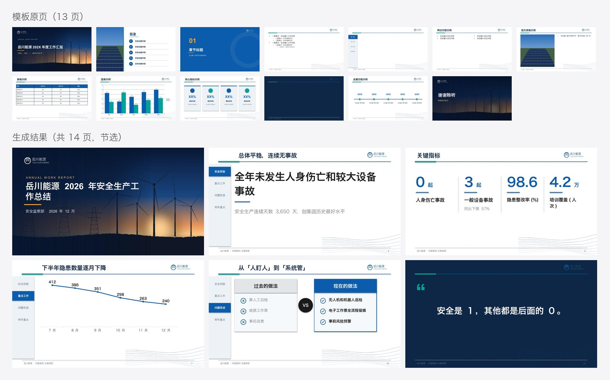

# 跨模型测试（第三轮）：GLM 5.3 + 复杂模板 + 没用标题样式的 Word

**目的**：模板换成「全部用母版和占位符搭、带章节导航条、尺寸是 10 × 5.625 英寸」的复杂企业模板，非 Claude 模型只靠这份 skill 能不能做对。

## 设置

- Agent：pi；模型：GLM 5.3（`zai-coding-cn`，thinking high）；`--skill` 加载本仓库的快照。这个模型不能读图。
- 模板：`examples/templates/energy-yuechuan.pptx`（13 页，岳川能源，虚构）。
- 内容：[`content.docx`](content.docx)，《2026 年安全生产工作总结》，**没用任何标题样式**：
  - 标题靠整段加粗；
  - 章节靠「一、」编号；
  - 有项目符号、手打编号、Word 表格和一句引语。
- 任务原文：

  > 使用 xiaoma-ppt skill，把 content.docx 这份 Word 的内容套进 template.pptx 这个公司模板，做一份安全生产年度总结 PPT，输出到 out/ 目录。全程自主完成，不要停下来问我。

## 结果

- 8 分 42 秒一次跑完，31 次工具调用，14 页，lint 0 ❌ 0 ⚠️。交付说明如实写了「未目视检查」。
- 它把 docx 直接交给 plan.py，读了转出来的 md 和 `deck-spec.md`，然后改 deck.json。
- 导航条：每个内容页都写了 `tracker`。它按 profile.md 的提示换成了 4 个字的短名（安全形势 / 重点工作 / 问题改进 / 明年重点），当前章的高亮跟着章节走。
- 版式：

  | 内容 | 版式 |
  |---|---|
  | 4 项关键指标 | 大数字 |
  | 隐患月度数量 | 原生折线图 |
  | 两组编号步骤 | 流程 |
  | 过去 / 现在 | 对比 |
  | 引语 | 模板的深色页 |

- 数字逐个和 Word 核对过，全部一致（0 起、3 起、同比下降 57%、98.6%、4.2 万人次、412 → 240 项）。
- 本目录的 `out/deck.pptx` 是用它的 `deck.json`，在当前引擎上重新构建的。

## 验收发现的问题和改动

| 问题 | 怎么发现的 | 改动 |
|---|---|---|
| 对比页第三项压在框的下边线上：「电子工作票全流程留痕」折成两行，这个模板内容区只有 2.9 英寸高 | 人工看渲染图（lint 没报） | ① 对比版式放不下时按缩小后的字号重算折行，逐步缩小（最小 70%）；② lint 新增「新内容超出内容区下沿」检查，这类问题不看图也能查出来 |
| 把两个小标题改写成了自己总结的结论句（「隐患排查月度数量」→「下半年隐患数量逐月下降」，另一个改成「按季度安排四项重点」），意思没错，但违反「原文只删减不改写」 | 对照原文 | SKILL.md 规矩 6 写明「包括页面标题」 |
| 「关键指标」选了模板里的 KPI 示例页（第 9 页），这页没有导航条，和其他内容页不一致 | 人工看渲染图 | 不改引擎：plan.py 的草稿用的是带导航条的页，是模型手动换的 `from`。deck-spec.md 已写明有进度标签的模板统一用带标签的页 |

## 结论

复杂模板上，GLM 5.3 只靠这份 skill 就用对了各种结构：
- 占位符模板、主题色；
- 章节导航条（会写短名、会移动高亮）；
- 没用标题样式的 Word 转换。

剩下的问题都是「要看一眼才知道」的版面细节，或者是对规矩理解得不够严格。前者已经在引擎和 lint 里兜住，后者已经写进文档。
