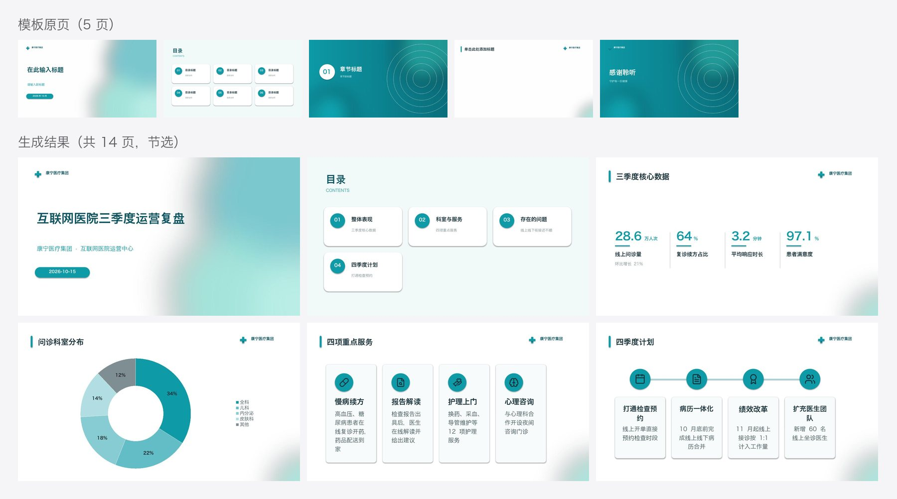

# 跨模型测试：pi + GLM 5.3 独立使用本 skill

**目的**：验证不是 Claude 的模型，只靠这份 skill，能不能把 md 套进企业模板，做出和示例同一水准的 PPT。

## 设置

- Agent：pi 0.85.1；模型：GLM 5.3（`zai-coding-cn`，thinking high）；用 `--skill` 加载本仓库的一份快照（测试期间不改动）。
- **这个模型不能读图。** 它打开了模板缩略图，但看不到内容，全程靠 `profile.md`、build 提示和 `lint.py` 判断。
- 输入：一份它没见过的 md（[`content.md`](content.md)，互联网医院季度复盘，4 章，含数字列表、两张表、卡片、对比、有序列表、引用）+ 医疗模板 `medical-kangning.pptx`。
- 任务原文（普通用户口吻，没有任何额外指导）：

  > 使用 xiaoma-ppt skill，把 content.md 的内容套进 template.pptx 这个模板，做一份季度复盘 PPT，输出到 out/ 目录。全程自主完成，不要停下来问我。

## 结果

- **一次跑完**：3 分 17 秒，20 次工具调用，不需要「继续」。
- 产出 14 页 [`out/deck.pptx`](out/deck.pptx)，`lint.py` 全绿，build 没有 ⚠️。交付说明里如实写了「未目视检查」。
- 它的 `deck.json` 原样保留在本目录（只把模板路径从测试目录改成了仓库里的模板）。

## 它做对了什么

- 按工作流 1–5 走完：读 SKILL.md → 拆模板 → 读画像 → 出草稿 → 读 `deck-spec.md` 和 `aesthetics.md` → 改 deck.json → build → lint → 渲染。
- 在草稿上做的修改都合理：
  - 折线图高亮 9 月峰值、环形图高亮全科占比
  - 把草稿自动配的图标换成更贴切的（慢病续方 → 药丸、报告解读 → 文件检索、护理上门 → 心形手）
  - 给流程四步各配了图标
  - 目录条目补上了副标题（模板目录卡片里有副标题位）
  - 每页都写了演讲者备注
- 数字逐个核对过，和 md 完全一致，没有编造。上屏文字都来自原文；改动只有一处删减：封面标题去掉了「2026 年」。

## 独立验收发现的问题

| 问题 | 怎么发现的 | 原因 |
|---|---|---|
| 金句页标题被设为 `null` 后，模板标题左边的青色竖条孤零零留在左上角 | 人工看渲染图（lint 没报） | 删标题时只删了标题文本框，没删紧贴标题的装饰 |
| 草稿里内容页的 `notes` 是空的，备注是模型自己补写的 | 对比草稿和它的 deck.json | `plan.py` 只把铺垫段落放进备注，漏了列表和表格本身 |
| 目录第 4 条的副标题用了「打通检查预约」（第 4 章第一步的名字），不太贴切 | 人工看 | 模型从章节下的第一个小标题取副标题；md 里这一章没有现成的一句话概括 |

## 据此对 skill 做的改动

1. `build.py`：删标题（`title: null`）时，把紧贴标题的小装饰（竖条、短横线、序号底）一起删掉，logo 和图片不动。
2. `plan.py`：草稿里每页的 `notes` 自动带上这一页对应的完整原文（段落、列表、表格），模型不用再自己补。

## 结论

只靠这份 skill，一个不能读图的非 Claude 模型，3 分钟做出了和 Claude 手做示例同一水准的 14 页企业模板 PPT：颜色字体全来自模板，版式选对了，数据没编，lint 全绿。剩下的问题集中在「要看一眼才知道」的装饰细节上，已经在引擎里兜住了。
