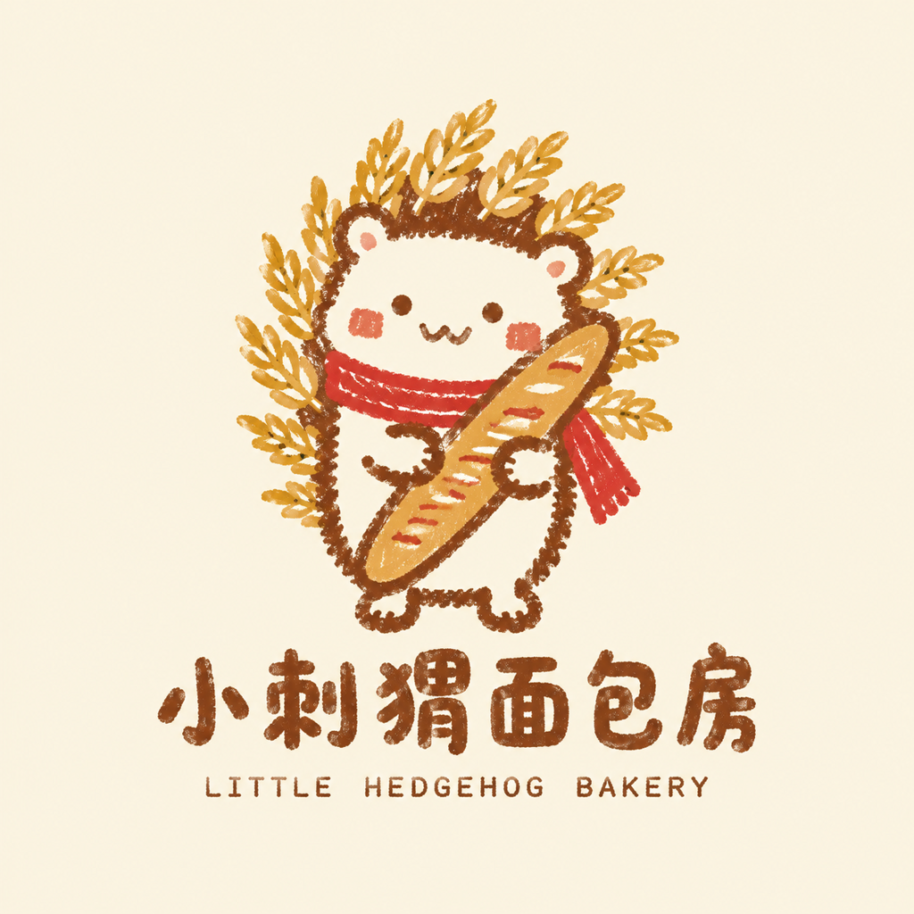

# 10 品牌 Logo / 社区小店标识

> Brief：社区面包房「小刺猬面包房 Little Hedgehog Bakery」的主标识，用于门头、纸袋、社交头像。
> 方法细节见 `../references/logo.md`，本案例演示完整决策链。

## L1 策略推演

| 项 | 决策 |
|---|---|
| 受众 | 住在店周边 1 公里内的上班族与亲子家庭 |
| 受众三问 | 功能=卖现烤面包；相关=早上顺路、周末带孩子；身份="我们这条街自己的小店" |
| 主诉求 | Pathos（亲切、有温度）为主，Ethos（手作可信）为辅 |
| 马斯洛 | 归属 |
| 故事钩子 | 刺猬背上的刺是一根根麦穗——"刚出炉、扎扎实实" |
| 基调关键词 | 亲切、手作、稚拙、温暖 |
| 核心信息 | 街角的手作面包房，有点可爱，有点用心 |

差异化：同街区烘焙店多走"麦穗 + 极简几何 + 衬线字"→ 本作走**手绘涂鸦角色**，用一个会被小孩指着叫名字的角色做记忆点。

## L2 规范决策

- **色板锁 3 色 + 底色**：焦糖棕（轮廓与文字）/ 麦黄（面包与麦穗）/ 暖红（围巾点缀）；底色暖米白。禁止第 5 色。
- **形状**：圆润、略不规则；轮廓为粗细不均的深色手绘线，内部平涂。
- **字体**：品牌名用手写粗圆体，英文副名用小一号等宽细体；中文逐字校对。
- **版面**：图形在上、文字居中在下；图形占 70%，文字占 30%；四周留安全区。
- **平面性**：无渐变、无阴影、无高光。
- **应用约束**：必须同时出方形头像版（仅图形）和单色版（仅焦糖棕）。

## L3 风格选择

风格词典命中：**手绘线稿**（亲切、人文）为底，叠加**日式手绘平涂**的介质感。
理由：小店 Logo 靠"有人在画"的温度建立信任；介质词用"蜡笔质感轮廓线、颗粒纹理、稚拙"，避免 AI 平均脸。

## 提示词模板

> 日式手绘风格的社区面包房品牌 Logo，蜡笔质感轮廓线，颗粒纹理，[底色：暖米白]纯色平涂背景，纯平面。
> 主体是一只[角色：小刺猬]，正面站立，双手抱着一根[法棍]；背上的刺画成[一根根麦穗]；脖子上系一条[暖红]小围巾。
> 五官极简：圆点眼睛、W 形微笑嘴，脸颊带一点腮红色块；四肢短圆，姿态略微前倾，显得憨厚。
> 线条为[焦糖棕]粗细不均、带抖动和毛边的手绘线，像用蜡笔直接画出来，不要精致、不要专业插画感；内部色块平涂。
> 仅使用[焦糖棕/麦黄/暖红]三种颜色加底色，无其他颜色。
> 图形下方居中排版品牌名"[小刺猬面包房]"，手写粗圆体、字母圆润略不规则；其下一行小字"[LITTLE HEDGEHOG BAKERY]"，等宽细体。品牌名逐字准确，零错字。
> 无渐变、无阴影、无高光、无 3D、无写实质感、无复杂背景；整体居中，四周留足安全区。

## 评审要点（本场景专属）

- [ ] 3 秒内说得出"这是面包房、气质亲切"
- [ ] 缩到 32px，刺猬轮廓仍可辨认
- [ ] 颜色不超过 3 色 + 底色
- [ ] 无渐变、阴影、高光
- [ ] "小刺猬面包房"六字零错字，英文拼写正确
- [ ] 方形头像版裁切后图形居中完整
- [ ] 单色版（仅焦糖棕）主体不糊
- [ ] 商用前做商标检索（见 `logo.md` 第 8 节）

## 成图（✅ 真实生图验证）

模板占位符按上文括号内的值填入，方形 1:1 出图，同提示词并行出 2 张，选色块更平、颗粒更像蜡笔的一张。

**验收对比**（左：缩到 32px 后放大；右：直接转单色）：

评审：84/100（L2+）。

- **L1 策略 ✓**：3 秒可读为"面包房、亲切"，刺猬 + 法棍 + 麦穗的钩子成立。
- **L2 规范**：
  - ✓ 品牌名"小刺猬面包房"六字与英文副名零错字；构图居中、留白充足；无阴影、无 3D。
  - ✗ 平面性不彻底：麦穗与法棍有轻微明暗层次。
  - ✗ 锁色被腮红突破：腮红是偏粉的第 4 个色相，原因是模板写了"腮红色块"却没把它并入暖红。
  - 32px：整体轮廓（圆形 + 红围巾 + 金色光晕）仍可辨认，文字不可读（符合预期）。
  - **单色：主体与文字成立，但麦黄色麦穗转单色后变成零散墨点，"刺 = 麦穗"的钩子丢了。**
- **L3 表现**：偏"精致治愈插画"，离"小朋友用蜡笔画的稚拙"还差一步；记忆点靠角色，不靠笔触。

## 复盘：下一版提示词怎么改

1. 腮红改写为"两个暖红色小圆点"，让颜色数真正锁死在 3 色 + 底色。
2. 补一句"所有色块边缘为蜡笔平涂，麦穗与法棍内部不要明暗过渡"，压掉渐变。
3. 单色版不要靠阈值转换：另出一版并在提示词里写"仅用焦糖棕单色，麦穗用轮廓线勾勒、内部留白"。

## 迭代方向（A/B）

- A：保持风格，把角色换成"小面包"拟人，看哪一个更适合做门头。
- B：只改第 2、3 段，生成 3 个角色变体，用同一套第 1、4、5、7 段保证系列感。
